# DataY · 轻量数据平台

> 数据平台可以很小，功能不打折。一套 DataY 跑起来，数据集成、维度建模、任务调度、高性能数仓、分析看板、智能问数 —— 全有。

🌐 **产品首页**: [http://datay.yuyuejia.com.cn/](http://datay.yuyuejia.com.cn/)

## 为什么是 DataY？

传统数据平台动辄十几台机器、上百 G 内存，部署复杂、运维成本高。DataY 的理念是：**用最极致的技术栈精简，交付最完整的数据能力。**

| 传统方案                             | DataY                              |
|----------------------------------|------------------------------------|
| 需要 Hadoop / Spark / 分布式调度等多套系统组件 | 一个 JAR，自研引擎，一体化部署，拒绝组件地狱           |
| 需要多台服务器起步                        | **2 核 4G** 即可跑通数据集成 → 数仓 → 问数的完整链路 |
| 技术栈多，运维门槛高，需要专职大数据工程师            | 零依赖启动，10 分钟搭好开发环境                  |

**DataY = DataX + Nifi + DolphinScheduler**，但它不是三个工具的拼盘，而是把这三类能力重新设计成一套运行时：

- 自研流批一体数据集成框架，负责「进得来、算得动」；
- 自研分布式调度框架，负责「调得准、跑得稳」；
- AI 原生能力，负责「用得上、可自动化」。

这里的“轻量”指的是**运行资源门槛低**，不是能力轻量。它不依赖 Hadoop、Spark 这类重型组件，一个 JAR 就能启动，支持 DuckDB 作为高性能分析引擎，也支持 Doris，CLickHouse等分析引擎。开发机 2 核 4G 就能跑通从数据接入到报表查询的完整链路。

## 项目结构

DataY 分两个子模块，Core 负责引擎，Web 负责平台产品：

```
datay/
├── pom.xml          # Maven 父模块
├── datay-core/      # 轻量、高性能、流批一体的数据集成引擎
├── datay-web/       # 可视化数据平台（任务设计 + 调度 + 数仓 + 看板 + 问数）
└── docs/            # 产品主页 + 帮助文档
```

## 平台核心能力

### 数据集成（Data Integration）

- 支持 MySQL / PostgreSQL / Oracle / 人大金仓 KingbaseES / SAP HANA / TDengine / Doris / ClickHouse / DuckDB 等二十余种数据源，并可通过 Apache Polaris 读写 Iceberg 数据湖
- 可视化拖拽画布编排 ETL 数据流，也可 JSON 配置文件一键跑任务
- 支持全量同步、增量同步、MySQL CDC / PostgreSQL CDC / Oracle CDC / 达梦 CDC / SQL Server CDC 实时同步
- 自动建表（DDL 转换），源表改字段自动同步到目标
- 支持跨库数据比对：按主键关联两侧表，DuckDB SQL 计算差异，结果文件写入本地或 MinIO

|                                 可视化 ETL 拖拽画布                                 |                                   多数据源统一接入                                    |
|:----------------------------------------------------------------------------:|:-----------------------------------------------------------------------------:|
| 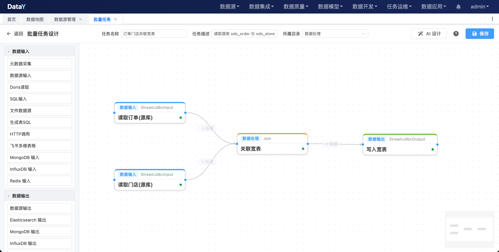 | 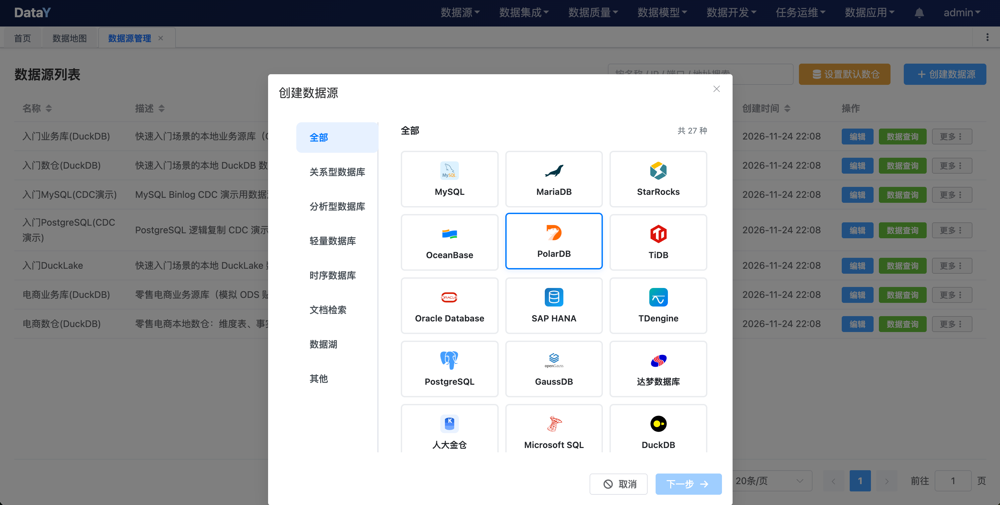 |

### 维度建模（Dimensional Modeling）

- 星型 / 雪花模型：可视化定义事实表与维度表的关联，沉淀业务语义层
- 三种维度类型：普通维度、层级维度、时间维度
- 事实表外键字段一键关联维度，指定时间周期字段，指标自动获得业务语义
- 维度 / 事实模型支持物化建表，数据直接落地到内嵌 DuckDB
- 为指标管理与智能问数提供统一的维度体系，指标口径不跑偏

|                                          事实表字段关联维度                                           |                                               指标数据血缘                                                |
| :---------------------------------------------------------------------------------------------------: | :-------------------------------------------------------------------------------------------------------: |
| 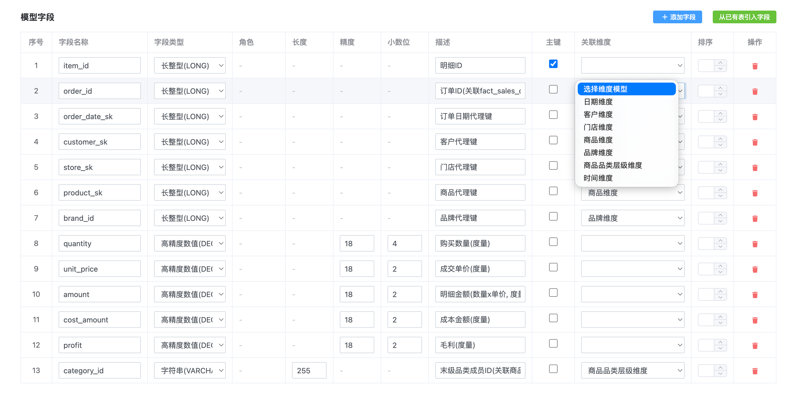 | 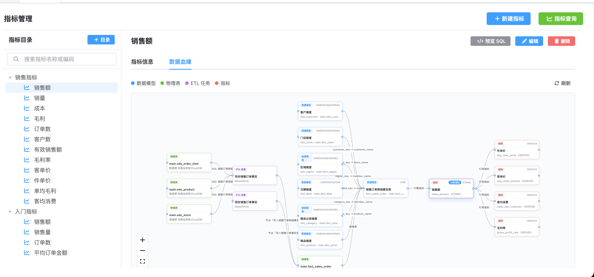 |

### 任务调度（Job Scheduler）

- Cron 定时调度，Quartz 引擎精准到秒
- DAG 工作流编排，支持嵌套工作流
- 支持手动触发、暂停/恢复、失败重试
- 调度 master 与执行 worker 可分离部署，单机就能跑，集群也能扩

|                                   DAG 工作流编排                                    |                                          任务实例执行日志                                           |
| :---------------------------------------------------------------------------------: | :-------------------------------------------------------------------------------------------------: |
| 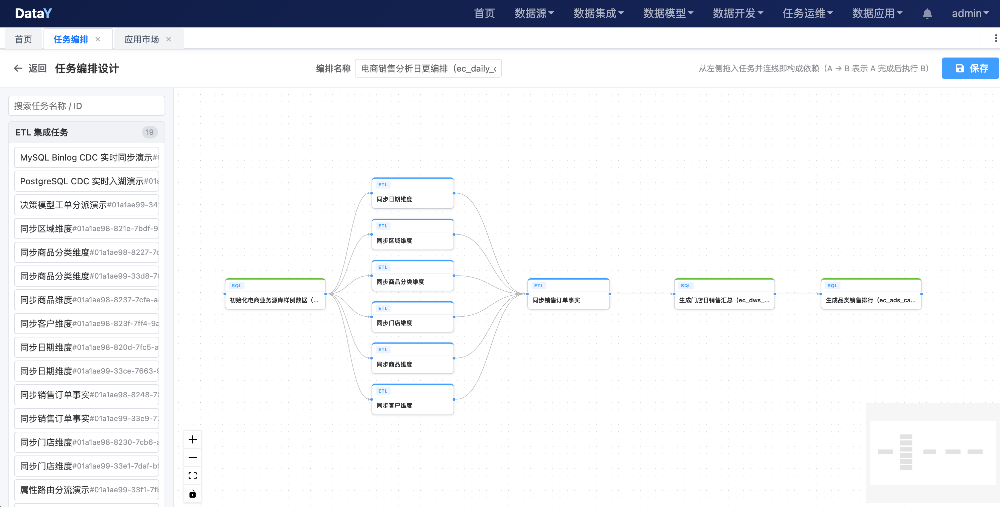 | 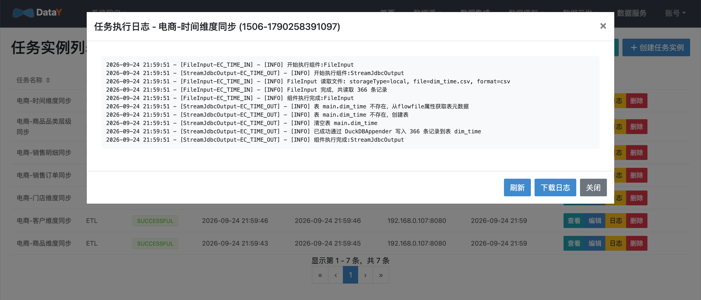 |

### 高性能数仓（High-Performance Warehouse）

- **内嵌 DuckDB**，列存 + 向量化 + 无锁并发，单机就能跑出分布式数仓的性能
- 与维度建模、指标管理打通，原子指标 / 衍生指标统一口径
- 支持 Doris / ClickHouse 流式加载，需要大规模查询可随时外挂
- 支持 DuckLake（Iceberg 格式）与 Apache Polaris（Iceberg REST Catalog），低成本构建数据湖

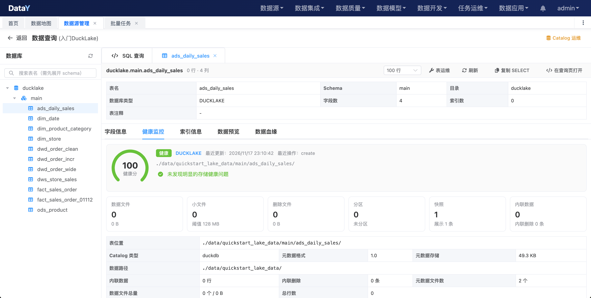

### 分析看板（Analytics Dashboard）

- 拖拽式可视化设计：栅格布局、组件缩放、撤销/重做、保存前预览，边设计边看效果
- 内置 16 种 ECharts 图表（柱状、折线、面积、饼图、环形、仪表盘、散点、雷达、漏斗、热力图、矩形树、瀑布、桑基、关系、箱线、地图），并提供 KPI、明细表、透视表与说明文本组件
- 数据集驱动：直接选用指标数据集或自定义 SQL 数据集，指标数据集自动继承维度、时间范围与统一口径
- 灵活的筛选器：日期区间、下拉、多选、文本与数值区间，可绑定多个数据集并支持下推，支持默认值
- 图表下钻：点击图形查看对应明细数据，保留点击条件并支持分页浏览
- 标准看板 + 固定分辨率大屏：提供常见大屏分辨率预设、contain / stretch / cover 适配与画布缩放，支持浅色 / 深色主题、纯色 / 渐变 / 背景图，以及定时自动刷新
- AI 看板助手：一句话生成数据集、图表、KPI、筛选器与布局，也可继续用自然语言修改现有看板
- 支持嵌入第三方系统：通过 `dashboard.html?id=<看板ID>&embed=1&token=<令牌>` 以 iframe 方式免登录展示，自动隐藏平台框架

|                                          指标数据集直接生成看板                                           |                                            AI 看板助手                                             |
| :-------------------------------------------------------------------------------------------------------: | :------------------------------------------------------------------------------------------------: |
| 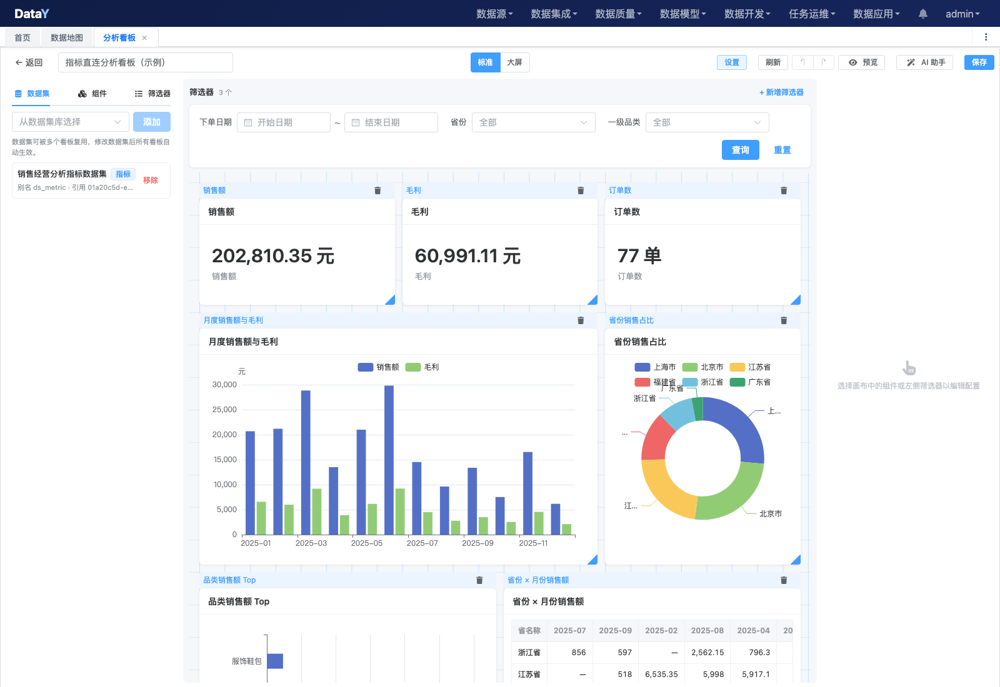 | 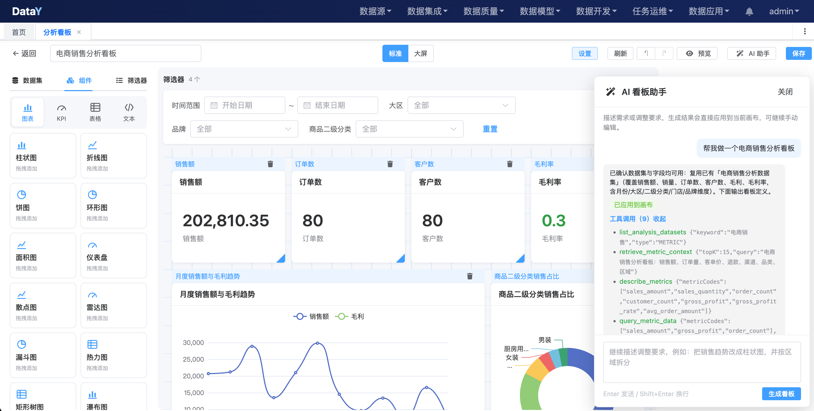 |

### 智能问数（AI Data Agent）

- 自然语言 → 指标 → 维度 → 时间过滤 → 取数，**一句话拿报表**
- RAG 本地向量索引，指标口径不跑偏
- 指标管理模块统一维护业务口径，问数有依据

|                                          智能问数入口                                           |                                           一次完整问数的解析与结果                                            |
| :---------------------------------------------------------------------------------------------: | :-----------------------------------------------------------------------------------------------------------: |
| 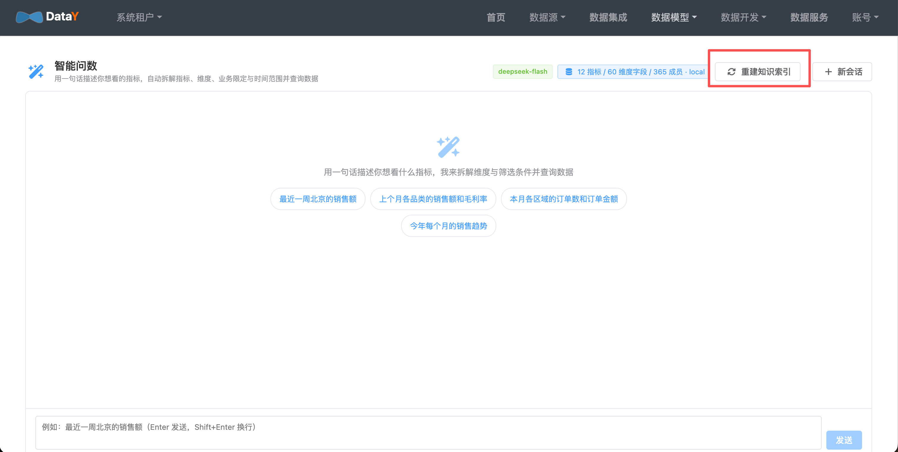 | 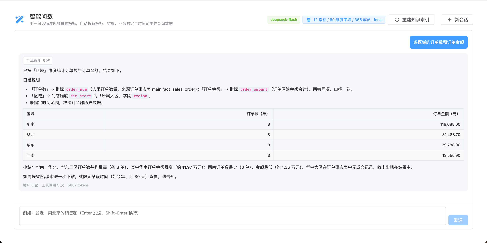 |

### MCP Harness（让 Agent 直接操作平台对象）

- 通过 MCP 端点 `/mcp/datay` 把**数据源、数据服务、ETL 任务、数据模型**的增删改查与运行类动作暴露给 AI Agent
- 同一端点提供**指标智能问数**能力（`metric_query_guide` / `list_metrics` / `describe_metrics` / `sample_dimension_values` / `query_metric_data` / `retrieve_metric_context`），与内置问数助手共用同一套实现与口径
- 同一端点也提供**指标定义管理**（`metric_*`：增删改查、SQL 预览、指标目录维护），与页面保存走同一套校验
- Claude Desktop / Cursor / DSH 等 MCP 客户端接上后，可自行完成「建数据源 → 建 ETL 任务并试跑 → 上线调度 → 建模并物化落表 → 一句话问指标」


## 环境要求

- Java 17+
- Maven 3.6+
- Node 22+（构建 DataY Web 前端）

> 使用 Doris Arrow Flight SQL 读取组件时，Java 启动参数需增加
> `--add-opens=java.base/java.nio=ALL-UNNAMED`；Docker 镜像已默认添加。

## 一键部署

**方式一：直接下载运行包**

```bash
# 下载
wget https://datay.yuyuejia.com.cn/download/datay-web.jar -O datay-web.jar

# 启动（单机模式，调度+执行合一），AI 能力需要提供 AI API Key，默认为 Deepseek 原厂Key
java -jar datay-web.jar --DATAY_AI_API_KEY=sk-xxxxxxxxx

# 浏览器打开 http://localhost:8080，默认账号 admin/admin
```

**方式二：从源码构建**

```bash
# 1. 克隆仓库
git clone https://gitee.com/yuyuejia/datay.git

# 2. 构建项目（默认包含全平台原生库）
cd datay
mvn clean package -DskipTests

# 仅构建指定平台的精简包（jar 小于 150MB）：
# mvn clean package -DskipTests -Dslim.jar.platform=linux-amd64
# 可选平台：linux-amd64 / linux-arm64 / macos / windows

# 3. 启动（单机模式，调度+执行合一），AI 能力需要提供 AI API Key，默认为 Deepseek 原厂Key
java -jar datay-web/target/*.jar --DATAY_AI_API_KEY=sk-xxxxxxxxx

# 4. 浏览器打开 http://localhost:8080，默认账号 admin/admin
```

在线演示地址：[http://datay-demo.yuyuejia.com.cn/](http://datay-demo.yuyuejia.com.cn/)

---

## Core 独立运行（嵌入 / CLI 模式）

```bash
# JSON 定义任务，直接跑
java -jar datay-core/target/datay-core-*-jar-with-dependencies.jar taskConfig.json
```

```json
{
  "units": [
    { ".name": "StreamJdbcInput", "table": "orders" },
    { ".name": "StreamJdbcOutput", "table": "orders_sync" }
  ],
  "connections": [{ "sourceId": "...", "targetId": "..." }]
}
```

## 常用场景案例

- [Mysql同步到Mysql](datay-core/docs/example/mysql-to-mysql.md)
- [Http同步到Mysql](datay-core/docs/example/http-to-mysql.md)
- [飞书多维表格同步到Mysql](datay-core/docs/example/feishu-bitable-to-mysql.md)
- [Mysql同步到飞书多维表格](datay-core/docs/example/mysql-to-feishu-bitable.md)
- [Mysql CDC实时同步到Mysql](datay-core/docs/example/mysqlCDC-mysql.md)
- [MySQL CDC实时同步到DuckDB](datay-core/docs/example/mysqlCDC-duckdb.md)
- [MySQL CDC实时同步到DuckLake](datay-core/docs/example/mysqlCDC-ducklake.md)
- [PostgreSQL CDC实时同步到DuckDB](datay-core/docs/example/postgresCDC-duckdb.md)
- [PostgreSQL CDC实时同步到DuckLake](datay-core/docs/example/postgresCDC-ducklake.md)
- [Oracle CDC实时同步到DuckDB](datay-core/docs/example/oracleCDC-duckdb.md)
- [达梦 CDC实时同步到DuckDB](datay-core/docs/example/dmCDC-duckdb.md)
- [SQL Server CDC实时同步到DuckDB](datay-core/docs/example/sqlServerCDC-duckdb.md)
- [Mysql同步到Apache Doris](datay-core/docs/example/mysql-doris.md)
- [Mysql同步到DuckLake](datay-core/docs/example/mysql-ducklake.md)
- [使用DuckDB SQL进行数据处理](datay-core/docs/example/mysql-sqlunit-mysql.md)

## 支持的数据源

- **关系型数据库**: MySQL系, Oracle, PostgreSQL系, SQL Server, MariaDB, 达梦（DM）, 人大金仓（KingbaseES）, SAP HANA
- **时序数据库**: TDengine（WebSocket / REST / 原生三种连接方式）
- **分析数据库**: DuckDB, Doris, ClickHouse, GreenPlum, YMatrix
- **数据湖**: DuckLake, Apache Polaris（Iceberg REST Catalog）
- **文件系统**: 本地文件、MinIO对象存储、CSV、EXCEL、Parquet
- **缓存 / KV**: Redis
- **CDC**: MySQL Binlog, PostgreSQL 逻辑复制（WAL / pgoutput）, Oracle LogMiner, 达梦 LogMiner, SQL Server CDC, MongoDB Change Streams

## 商业支持
DataY 开源免费，遵循对应开源协议，个人与企业均可免费下载、评估使用。
如果您企业需要落地生产环境，可购买作者提供的商业服务，保障业务稳定运行：

服务清单
- 私有化部署、高可用架构落地、信创适配
- 远程技术支持、SLA 应急保障
- 定制开发：数据源扩展、业务算子、报表大屏、多租户改造、SSO登录
- 性能调优、压测、CDC/流批链路诊断
- 培训服务：运维培训、开发培训、数据建模实战
- 版本代升级、迁移、巡检、年度维保包

重要说明
- 开源社区 Issue 尽力支持，不承诺响应时效；生产问题请走商业支持通道
- 商业服务为作者独立提供，不改变开源代码本身协议

## 联系方式

有问题或建议，请通过项目 Issue 或加微信进行反馈，我们会尽快回复您。

| 作者微信 | 技术交流群 |
| :---: | :---: |
|  |  |

## 奖赏
如果你觉得 DataY 对你有帮助，欢迎给项目 Star、分享推荐给身边同行。
也可以请作者喝杯咖啡，支持项目持续迭代、修复 Bug、新增数据源与能力。


