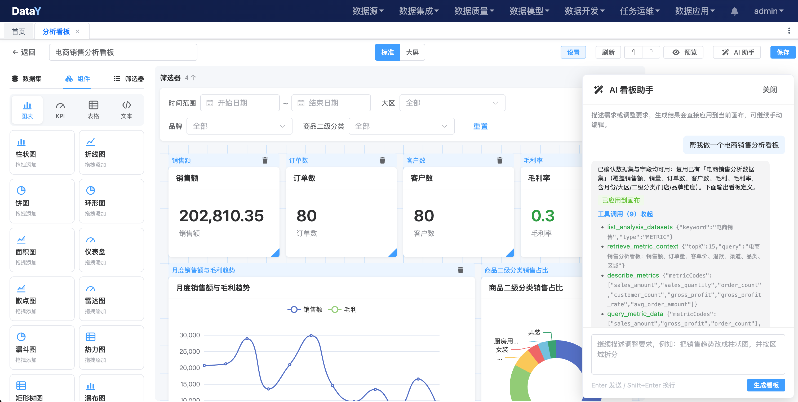

# 一句话生成分析看板：DataY 上线 AI 看板助手，把「等排期」变成「边聊边改」

> 做一个看板，难的从来不是画图。
>
> 难的是把一句业务问题，翻译成指标、维度、口径、图表和筛选器——而且翻译得让所有人都认。

---

## 一、看板为什么总是「慢半拍」

周一上午，业务负责人在群里发了一句：

> 「帮我看下最近各区域、各品类的销售和毛利，再按门店排个 Top10，最好能按时间筛一下。」

这句话，人人都看得懂。

但落到数据团队手里，它会迅速展开成一条很长的链路：

```text
业务问题
  ↓
销售额按哪个口径？含不含退款？含不含运费？
区域用大区、省份还是城市？时间按自然月还是滚动 30 天？
  ↓
找表 → 写 SQL → 建数据集 → 选图表 → 配字段 → 调布局 → 加筛选器
  ↓
发布 → 培训 → 业务对数 → 改口径 → 再来一轮
```

真正用于「分析」的时间，往往不到整件事的三分之一。

### 痛点一：需求到看板，中间隔着一条「翻译链」

业务说的是「卖得好不好」，平台要的是「指标编码 + 维度字段 + 聚合方式 + 时间范围 + 图表类型」。

每一次翻译都要靠人。每多一个人参与，就多一次理解偏差的机会。

### 痛点二：口径不在平台里，在人的脑子里

同一个「销售额」，在财务、运营、电商负责人嘴里，可能对应五种算法：下单金额、支付金额、应收金额、含税/不含税、含不含运费。

口径如果只存在于 SQL 和聊天记录里，看板就会陷入一种循环：

> 做图一小时，对数一整天。

### 痛点三：配置门槛，把最懂业务的人挡在门外

数据集、字段、聚合、坐标轴、图例、排序、Top N、筛选器联动、栅格布局……工具越专业，业务同学越难自己动手。

于是最懂问题的人只能提需求，最懂工具的人却在猜业务。

### 痛点四：一次性需求，吞掉了数据团队

周会看板、活动大屏、临时复盘、老板随口一句「能不能再加个维度」——需求来得急，改得也快。

数据团队被大量「报表工单」占满，真正该做的建模、治理、性能优化，只能往后排。

### 痛点五：看板做完，常常已经过时

等排期、等开发、等对数，一周过去，业务关注点已经换了。看板不是没价值，而是价值被交付周期消耗掉了。

---

## 二、AI 看板助手：把「说需求」变成「出看板」

DataY 新增的 **AI 看板助手**（看板设计助手），入口就在「分析看板 → 看板设计」的右上角：**AI 助手**。

打开后，你不需要先选数据集、先想图表类型，只需要把问题说出来：

- 「帮我做一个电商销售分析看板」
- 「生成一个按区域和品类分析销售与毛利的看板」
- 「做一个近期订单趋势与门店 Top10 的看板」

片刻之后，一份包含数据集引用、图表、KPI、筛选器和布局的看板，会直接出现在当前画布上。



*图：右侧是 AI 看板助手的对话与工具调用过程，左侧是生成后可直接编辑的看板画布*

从截图里可以看到几个关键信息：

- 助手完成了 **9 次工具调用**：查已有数据集、做指标语义检索、拉取指标元数据、生成前取数验证；
- 生成结果包含 **4 个全局筛选器、4 张 KPI 卡、月度趋势图和品类占比图**；
- 面板中明确标注「已应用到画布」，生成后可以继续拖拽、改图、换字段；
- 工具调用过程对用户可见、可展开，不是一次黑盒输出。

它背后的工作，大致分三步。

### 第一步：先找数据集，而不是先写 SQL

助手不会一上来就拼 SQL、查数据库。

它会先看平台的**数据集库**里，有没有能覆盖本次需求的指标数据集：

- 有，就直接复用，避免为每个图表重复造数据集；
- 没有，就根据真实指标、维度、业务限定和时间范围，准备一份数据集草稿。

指标编码、维度字段、展示字段，全部来自平台的指标管理和维度建模，而不是模型「觉得应该叫什么」。

### 第二步：按分析意图选图、排布局

数据集确定后，助手才开始设计看板：

- 看趋势，用折线图或面积图；
- 做对比，用柱状图；
- 看占比，用饼图、环形图、漏斗图；
- 看核心数字，用 KPI 卡片或仪表盘；
- 看明细，用表格；看交叉汇总，用透视表；
- 看多维关系，用热力图、散点图、桑基图。

同时生成 24 栅格布局、组件标题、全局筛选器，并控制组件不重叠、不越界。

### 第三步：生成可编辑的看板定义，直接落到画布

最终产物不是一张截图，也不是一段无法维护的代码，而是一份 **v2 看板定义**：

- 数据集只保存引用，不内嵌 SQL 或指标定义；
- 图表类型、字段映射、聚合方式、布局、筛选器都是结构化配置；
- 生成结果直接应用到当前设计器，可以继续手动调整；
- 支持撤销/重做，**不会自动保存，更不会自动发布**。

也就是说，AI 负责把骨架搭出来，最终是否保存、是否上线，仍然由人决定。

---

## 三、为什么它生成的看板「能直接用」

很多 AI 生成工具的问题，不是不会生成，而是「看起来很对，实际跑不起来」。

DataY 的看板助手在几个关键环节做了约束。

### 1. 数据集是复用的，不是一次性的

看板只允许引用数据集库中的数据集，禁止在 spec 里内嵌 `metricQuery`、`sql`、`params` 或数据源信息。

这样做有三个直接好处：

- **口径统一**：同一个指标，多个看板引用的是同一份定义；
- **权限统一**：查询仍然走平台的数据集与指标查询接口；
- **维护简单**：口径变了改数据集，不用逐个看板改 SQL。

如果数据集库里没有合适的数据集，助手会在生成结束后，把草稿统一落库为正式数据集，而不是把一堆临时 SQL 留在看板里。

### 2. 字段是真实的，不是编的

模型可以调用平台工具，查询真实的指标目录、指标元数据、维度信息和维度成员值：

- 「销售额」对应哪个指标编码；
- 「门店」应该展示 `store_name`，而不是 `store_sk`；
- 时间维度支持年、季、月、日哪种粒度；
- 「北京」到底挂在城市、省份还是大区字段上。

所有指标编码、维度编码、字段名都必须来自工具返回的真实元数据。模型不能凭空发明一个字段，也不能拿代理键直接上图。

### 3. 结构是校验过的，不是「看起来对」

大模型生成 JSON，难免会出现结构偏差。DataY 在严格校验之前，会先做一层自动修复：

- 漏写 `chart.type`，从 `echartsOption` 中推断；
- 仍在使用旧版 `encode` 字段，自动转换为 v2 结构；
- 透视表维度角色写错，自动纠正为 `row` / `column`；
- 同一组件内字段重复，按优先级去重；
- `refId` 无效，优先恢复为本次生成的数据集或按名称匹配已有数据集。

修复不了的，交给严格校验器拦截：

- 顶层 `version` 必须为 2；
- 图表类型、维度角色、度量角色、聚合方式必须合法；
- 热力图、桑基图必须有 `x + series`；
- 透视表必须有 `row + value`；
- 组合图引用的度量必须已声明；
- 条件格式的操作符、阈值、颜色必须合法；
- 字段必须真实存在于数据集中。

单个看板最多 50 个数据集、200 个组件、100 个筛选器；单个 spec 最大 100 万字符。边界清晰，才不会生成一个「打不开的看板」。

### 4. 生成是草稿，不是自动上线

AI 生成结果会直接进入画布，但不会自动保存。

你可以先看布局、改图表、换字段、调筛选器，确认无误后再保存和发布。生成错了，按 `Ctrl/Cmd + Z` 撤销即可。

### 5. 可以继续对话，也可以手动改

助手会带着当前看板定义作为上下文。你可以继续说：

- 「把区域这张图改成柱状图」
- 「再加一个门店销售额 Top10」
- 「按月份看订单趋势」
- 「把销售额和毛利率放到同一张组合图里」

它会输出调整后的完整看板，保留你没有要求变更的部分，已有组件 id 尽量保持不变。

如果你更习惯手动操作，生成后的每一个组件、每一条筛选器、每一个布局位置，都可以在设计器里继续编辑。

---

## 四、生成只是开始：看板还要「跑得动、管得住」

AI 把看板做出来，只是第一步。真正上线后，看板还要面对数据量、并发、权限和分享。

DataY 在这些环节也做了配套：

### 图表与组件

- 15 类 ECharts 图表：柱状、折线、面积、饼图、环形图、仪表盘、散点、雷达、漏斗、热力图、矩形树图、瀑布图、桑基图、关系图、箱线图；
- 支持组合图、双轴、堆叠、百分比堆叠、横向柱状；
- 组件类型覆盖 KPI、明细表、交叉透视表和安全 HTML 说明；
- 表格、透视表、KPI 支持条件格式。

### 筛选与性能

- 筛选器统一由服务端执行，前端不做本地过滤，避免「页面显示对了、导出却不对」；
- 分组聚合尽量下推到数据库，透视表直接按行、列、值聚合，不用先拉全量明细；
- 已保存看板的查询结果带 30 秒内存缓存、256 条 LRU，筛选值或查询条件变化才重新请求；
- 表格支持服务端分页，大表不必一次拉完。

### 大屏与分享

- 标准看板和大屏两种布局模式；
- 大屏支持分辨率、适配方式、明暗主题和自动刷新；
- 看板可以独立打开，也可以通过 iframe 嵌入现有系统，配合 URL Token 实现免登录。

### 权限与口径

- 看板查询复用平台的数据集与指标权限；
- 行级数据范围由服务端拼进查询条件，而不是靠提示词约束；
- AI 问数、指标面板、分析看板使用同一套指标口径。

---

## 五、几个典型场景

### 场景一：周会经营看板

周一早上说一句「做一个按区域、品类、门店分析销售和毛利的看板」，先让 AI 把骨架搭出来。

会上讨论到哪，就在对话里改到哪：加一个维度、换一种图、补一个筛选器。会开完，看板也基本成型。

### 场景二：活动大屏

促销、发布会、直播复盘，往往需要一块临时大屏。等排期不现实，让 AI 先按「核心指标 + 趋势 + Top 榜 + 实时明细」生成一版，再人工调整视觉和刷新频率。

活动结束，看板下线，不留维护负担。

### 场景三：业务自助分析

业务同学最清楚自己要什么，但往往卡在「不会配」。

现在可以先描述问题，让 AI 生成第一版；数据同学只需要校准口径、补充业务限定，而不是从零开始搭。

### 场景四：新人接手与交接

一个看板背后的数据集、指标、维度和筛选逻辑，都沉淀在结构化定义里。

新人接手时，不用靠翻聊天记录猜「这个数是怎么算的」，打开数据集和指标定义就能看懂。

---

## 六、DataY：让 AI 长在数据链路上

AI 看板助手不是孤立的功能，它长在 DataY 的数据集、指标和权限体系之上。

**DataY 是一套开源、轻量的一体化数据平台**，理念很简单：

> 数据平台可以很小，功能不打折。

传统数据平台往往需要 Hadoop、Spark、Flink、ClickHouse 一整套组件，几十台机器起步，运维门槛高。DataY 选择另一条路：

- **一个 JAR**，自研流批一体数据集成引擎，拒绝组件地狱；
- **2 核 4G** 就能跑通「数据集成 → 数据建模 → 数据开发 → 任务调度 → 数据应用」的完整链路；
- 零依赖启动，10 分钟搭好开发环境；
- 内嵌 DuckDB 作为高性能分析引擎，同时支持 Doris、ClickHouse 等外部分析引擎；
- 调度 master 与执行 worker 可分可合，单机和集群同一套代码。

这里的「轻量」指的是**运行资源门槛低**，不是能力轻量。

DataY 由两块组成：

| 模块 | 定位 | 说明 |
| --- | --- | --- |
| **DataY Core** | 数据集成引擎 | 轻量、可嵌入、可扩展、流批一体；JSON 定义任务、自动建表、CDC 实时同步；可脱离 Web 独立运行或嵌入 Java 应用 |
| **DataY Web** | 可视化数据平台 | 拖拽式任务设计、任务调度、维度建模、指标管理、智能问数、分析看板 |

平台的核心能力包括：

- **数据集成**：MySQL、PostgreSQL、Oracle、SQL Server、Doris、ClickHouse、DuckDB 等二十余种数据源，支持全量、增量与 CDC 实时同步；
- **维度建模**：星型 / 雪花模型，普通维度、层级维度、时间维度，事实表外键一键关联；
- **任务调度**：Quartz Cron 精确到秒，DAG 工作流编排，失败重试与暂停恢复；
- **高性能数仓**：内嵌 DuckDB，列存 + 向量化，支持 DuckLake 数据湖，也可外挂 Doris / ClickHouse；
- **智能问数**：自然语言 → 指标 → 维度 → 时间过滤 → 取数，一句话拿报表；
- **分析看板**：数据集管理、AI 生成看板、24 栅格设计器、大屏与嵌入分享；
- **AI 原生能力**：AI SQL 查询助手、ETL 任务设计助手、看板设计助手、智能问数助手、Java 脚本助手，以及面向 Agent 的 MCP Harness。

AI 能力兼容 OpenAI Chat Completions 协议，OpenAI、DeepSeek、通义千问、Ollama 等模型服务都可以对接。默认使用 DeepSeek，启动时通过 `DATAY_AI_API_KEY` 配置即可。

### 10 分钟跑起来

```bash
git clone https://gitee.com/yuyuejia/datay.git
cd datay
mvn clean package -DskipTests
java -jar datay-web/target/*.jar --DATAY_AI_API_KEY=sk-xxxxxxxxx
# 浏览器打开 http://localhost:8080，默认账号 admin/admin
```

进入「数据应用 → 应用市场」，一键初始化「电商销售分析应用」，再打开「分析看板 → 看板设计」，点右上角「AI 助手」，输入：

> 「做一个按区域和品类分析销售与毛利的看板」

产品首页：<http://datay.yuyuejia.com.cn/>  
在线体验：<http://datay-demo.yuyuejia.com.cn/>  
项目地址：<https://gitee.com/yuyuejia/datay>  
<https://github.com/yuyuejia/datay>

---

## 七、写在最后

看板从来不是「把图画出来」这么简单。

它背后是业务问题的拆解、指标口径的统一、维度体系的沉淀，以及数据权限的边界。这些判断，AI 目前替代不了，也不应该替代。

AI 能做的，是把那些重复、琐碎、容易出错的准备工作接过去：

- 帮你找数据集；
- 帮你选图表；
- 帮你配字段；
- 帮你排布局；
- 帮你检查那些「一看就不对」的结构问题。

剩下的——业务口径、分析结论、上线确认——仍然交给人。

这或许才是 AI 在数据分析场景里更合理的位置：

> 不是替你做决定，而是让你更快地做出更好的决定。

如果你也在被「等排期、对数、改看板」困扰，不妨试试 DataY 的 AI 看板助手。

**一句话描述问题，剩下的交给画布。**
