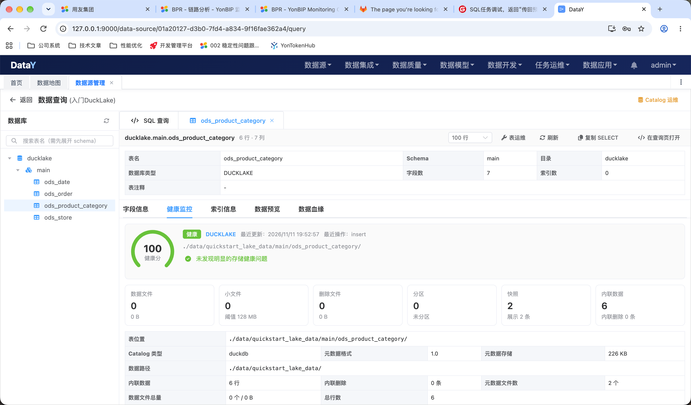

# 数据湖也会“亚健康”：DuckLake 表健康监控与运维实践

> 从“看得见”到“管得住”，让数据湖治理成为日常操作。

---

很多数据湖表刚上线时都很健康：文件不多、查询很快、存储也还算克制。

但运行几个月后，问题开始慢慢出现：

- 小文件越来越多，查询规划越来越慢；
- 删除文件不断堆积，读放大越来越明显；
- 快照和元数据持续膨胀，存储成本悄悄上涨；
- 小批量写入留在元数据里，Catalog 压力越来越大。

这些问题通常不会以“红色告警”的形式出现，而是以一句“最近查询好像有点慢”被感知。

DataY 做的事情，是把 DuckLake 表的健康监控和常用运维操作，直接放进日常的数据查询页面：既能看清一张表哪里不健康，也能在同一个界面里完成维护。

---

## 01 DuckLake 的“健康问题”，往往不是突然发生的

DuckLake 的架构很清晰：元数据放在 Catalog 中，业务数据以 Parquet 文件存储，删除通过删除文件或内联删除记录表达，查询时采用 merge-on-read。

这套设计让写入和删除都很轻量，但也带来了几个需要持续关注的问题：

1. **小文件累积**

   高频小批量写入会不断产生小 Parquet 文件。文件数量一多，查询规划、文件打开和 IO 开销都会上升。

2. **删除文件累积**

   DuckLake 删除数据时不一定立刻重写原文件，而是先记录删除信息。删除比例高了，读取时要做更多合并和过滤。

3. **内联数据膨胀**

   小写入会优先内联在元数据中。内联数据太多，Catalog 会变重，元数据读写也会变慢。

4. **快照与元数据增长**

   快照支撑时间旅行和版本回溯，但旧快照和不再引用的文件如果长期不清理，会持续占用存储，也会增加元数据管理成本。

所以，数据湖表不是“建完就一劳永逸”，而是需要像数据库一样做定期体检和维护。

---

## 02 健康监控：先看清一张表的“体检报告”

在 DataY 的数据查询页面，打开任意一张 DuckLake 表，切换到「健康监控」页签，就可以看到这张表的体检结果。

核心指标包括：

| 指标 | 关注点 |
| --- | --- |
| 数据文件数 / 总大小 / 平均文件大小 | 文件是否过小、是否过度分散 |
| 小文件数 | 默认以 128 MB 为阈值，识别小文件问题 |
| 删除文件数 / 删除大小 | merge-on-read 是否带来读放大 |
| 内联数据行数 / 内联删除行数 | 元数据是否承载了过多小写入 |
| 分区字段 / 分区数量 | 分区是否合理，是否存在过细或缺失 |
| 快照数量 | 版本历史是否过多，是否需要过期 |
| 元数据文件数 / 大小 | 查询规划和元数据读取成本 |
| 总行数 / 总大小 | 表规模基线，便于横向对比 |

除了具体指标，健康监控还会给出一个 **0–100 的健康分**：

- **≥ 85：健康**
- **60–84：警告**
- **< 60：严重**

健康分不是考核指标，而是一个排查入口。真正有价值的是分数背后的原因：是小文件太多，还是删除比例过高，还是快照长期没有清理。



上图来自 DataY 的实际页面：`ducklake.main.ods_product_category` 当前健康分 100，数据文件 0 个、内联数据 6 行、快照 2 个、元数据约 226 KB。

这是一张刚写入不久的小表，数据还停留在内联区，尚未形成物理小文件，所以健康分很高。但内联行数也在提醒我们：随着写入继续，需要关注落盘时机。**健康分是一个瞬间快照，不是一劳永逸的结论。**

页面会同时给出风险提示，例如：

- 小文件占比过高，建议执行 compaction；
- 删除文件较多，建议重写含删除记录的数据文件；
- 快照数量偏多，建议配置快照保留策略；
- 元数据体积偏大，建议检查内联数据和小文件情况。

---

## 03 DataY 怎么做：基于元数据的轻量体检

DuckLake 的健康监控并不需要扫描全表业务数据。

DataY 复用 DuckDB 的 DuckLake 扩展能力，直接读取 DuckLake 的元数据表，比如：

- `ducklake_table`
- `ducklake_data_file`
- `ducklake_delete_file`
- `ducklake_file_column_stats`
- `ducklake_snapshot`

再结合 `ducklake_table_info` 等函数，就能得到数据文件、删除文件、内联数据、分区、快照和元数据规模等信息。

这样做有几个好处：

- **轻量**：主要读取元数据，不触发业务数据全表扫描；
- **及时**：每次打开健康页签都能看到最新状态；
- **低侵入**：不需要额外部署一套独立的健康检查服务；
- **可扩展**：同一套思路也可以复用到其他数据湖格式。

健康页签采用按需加载：只有切换到健康监控时才发起请求，不会影响日常查询的首屏速度。

---

## 04 运维管理：从“发现问题”到“解决问题”

只有监控还不够。真正的闭环，是看到问题之后能安全地执行维护。

DataY 在表详情页提供了两类运维入口。

### 表级运维

表级操作与「刷新」按钮并列，只影响当前表，包括：

- **刷新元数据**：重新读取当前表的最新元数据；
- **落盘内联数据**：把内联在元数据中的行写入 Parquet 文件；
- **合并小文件**：合并相邻的小文件，减少文件数量；
- **清理删除标记**：重写删除比例较高的数据文件，清理 position、equality 和内联删除标记。

底层对应 DuckLake 的维护函数，例如：

```sql
CALL ducklake_merge_adjacent_files(
  'ducklake',
  'orders',
  schema => 'main'
);

CALL ducklake_rewrite_data_files(
  'ducklake',
  'orders',
  schema => 'main',
  delete_threshold => 0.95
);
```

### Catalog 级运维

Catalog 级操作位于「数据查询」页面顶部 header 右侧，作用于整个 DuckLake Catalog。DuckLake 下不需要打开表详情，也能直接执行。

包括：

- **过期快照**：按保留天数清理旧快照；
- **清理旧文件**：删除已调度删除且超过保留期的文件；
- **清理孤儿文件**：删除 Catalog 未跟踪的 Parquet、Puffin 文件；
- **一键维护**：通过 `CHECKPOINT` 串行执行落盘、合并、重写、清理等完整维护流程。

Catalog 级操作的影响范围更大，因此界面会明确提示作用域，并对删除类操作默认开启 **演练模式（dry-run）**：先展示将被删除的文件或快照，确认影响范围后，再关闭演练真正执行。

执行运维操作需要管理员或租户管理员权限，避免误操作。

---

## 05 一套可落地的运维节奏

有了工具，还需要节奏。下面是一套比较稳妥的实践建议：

1. **每天看健康分和风险提示**

   重点关注小文件数、删除文件数、内联数据和快照数量。

2. **先演练，再执行**

   过期快照、清理旧文件、清理孤儿文件，先跑 dry-run，确认列表无误后再执行。

3. **表级优先，Catalog 级谨慎**

   单表问题优先用表级 compaction；只有当多个表普遍存在旧快照、旧文件时，再考虑 Catalog 级维护。

4. **避开业务高峰**

   合并和重写会读取、写入大量文件，建议放在低峰期执行。

5. **快照保留时间按业务 SLA 设定**

   7 天只是一个起点。对需要长期时间旅行的表，应该设置更长的保留周期，不要为了省空间盲目过期。

6. **大变更后做一次完整维护**

   大批量导入、频繁删除或结构调整后，可以执行一次 `CHECKPOINT`，让表尽快回到健康状态。

一个简单的节奏可以是：

- **每日**：查看健康分与风险提示；
- **每周**：合并小文件、落盘内联数据；
- **每月**：演练并清理旧快照、旧文件；
- **大变更后**：执行一次完整维护。

---

## 06 写在最后

数据湖的运维，不应该只掌握在少数专家的脚本里。

它应该是平台里的日常能力：

> 健康可观测，问题可定位，操作可执行，风险可控制。

DataY 把 DuckLake 的表健康监控和运维管理放进数据查询页面，就是希望让“数据湖治理”从一次性排查，变成可持续的日常动作。

如果你也在使用 DuckLake，欢迎体验这套健康监控与运维能力，也欢迎把使用中的问题和建议反馈给我们。
