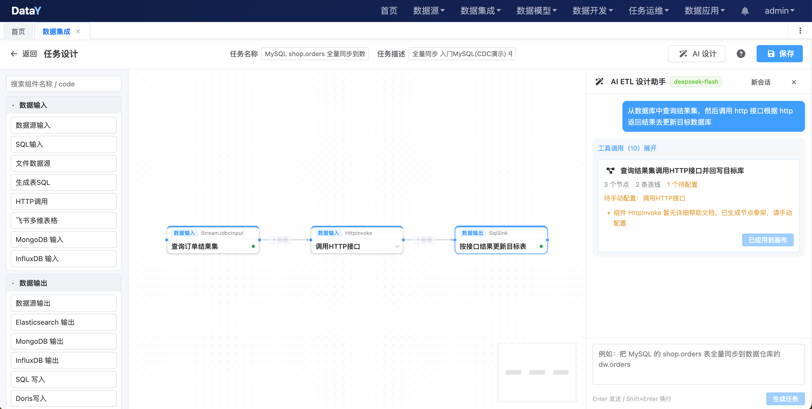

# 一句话生成 ETL 任务：DataY 上线 AI 设计助手，把数据集成从“拖拽配置”变成“对话生成”

> 数据集成最耗时的，往往不是写 SQL，而是把一个业务需求翻译成一条完整、可运行的数据流程。

---

## 一、ETL 任务设计，为什么总是“看起来简单，做起来慢”？

做过数据集成的人，大多经历过这样的场景：

业务方说：“把 MySQL 里的订单表同步到数仓，再和用户表关联一下，每天凌晨跑一次。”

听起来是一句话，落到 ETL 设计器里，却意味着一连串动作：

- 先判断用哪个输入组件：`StreamJdbcInput`、`JdbcInput` 还是 `SqlInput`？
- 再确认源库、schema、表名、增量字段；
- 然后选择处理组件：要不要 `Join`？要不要 `DataTransform`？字段怎么映射？
- 最后选择输出组件：`StreamJdbcOutput`、`JdbcOutput`，还是按数据模型写入？
- 每个节点还有一堆配置项：写入模式、过滤条件、字段映射、并发数、队列容量……

组件越多，配置越细，问题也随之而来。

### 痛点一：组件多、配置多，新人上手成本高

DataY 内置了丰富的 ETL 组件，覆盖输入、处理、输出、CDC、文件、HTTP、消息队列等场景。能力越强，选择越多。

但对刚接触平台的同学来说，光是搞清楚“这个场景该用哪个组件”，就要翻不少文档。

### 痛点二：表结构不熟，配置靠猜

明明只是想同步一张表，却要先确认：

- 数据源 ID 是多少？
- 表在哪个 schema？
- 增量字段叫什么？
- 关联字段两边类型是否一致？

如果凭经验猜表名、猜字段，调试时就会反复报错。

### 痛点三：文档和配置“两张皮”

很多平台都有帮助文档，但文档是文档，配置是配置。

文档里写的是引擎参数，设计器里填的是设计器字段；文档更新了，配置界面可能还没同步。用户只能一边翻文档，一边试配置。

### 痛点四：从需求到可运行任务，链路太长

一个中等复杂度的同步任务，从理解需求、选组件、连流程、填配置，到调试通过，往往要花上几十分钟甚至更久。

而这其中，真正需要人判断的业务口径并不多，大量时间花在了“查、找、填、连”上。

---

## 二、AI 设计助手的思路：把重复劳动交给 AI，把业务判断留给人

DataY 新增的 **ETL 任务 AI 设计助手**，目标不是“替代数据工程师”，而是把任务设计中最繁琐的部分自动化：

> 查组件、读文档、看表结构、拼流程、填基础配置，交给 AI；  
> 业务口径、数据质量、上线确认，仍然由人负责。

入口就在 ETL 任务设计页右上角：**AI 设计**。

用户只需要用一句话描述需求，例如：

> 把 MySQL 的 `shop.orders` 表全量同步到数据仓库的 `dw.orders`。

AI 会先做几件事：

1. 查询平台里有哪些 ETL 组件，哪些组件有详细帮助文档；
2. 读取相关组件的功能说明、配置参数和示例；
3. 查询真实的数据源、schema、表和字段；
4. 如果需要模型写入，还会查询真实的数据模型；
5. 最后生成一份包含节点、连线和基础配置的任务定义。

生成结果会先在右侧面板中预览，用户确认后点击 **应用到画布**，再检查、补全、保存。

AI 不会自动保存任务，也不会自动执行任务。

---

## 三、实拍：一句话，生成一条跨系统数据流

下面这张图，是 DataY ETL 设计页里的真实生成结果。

> 用户输入：从数据库中查询结果集，然后调用 HTTP 接口，根据 HTTP 返回结果去更新目标数据库。



*图：DataY ETL 任务设计页，右侧为 AI ETL 设计助手*

从截图里可以看到几个关键信息：

- AI 完成了 **10 次工具调用**，查询组件目录、组件帮助文档、数据源和表结构；
- 自动生成了 **3 个节点、2 条连线**：数据源输入 → HTTP 调用 → SQL 写入；
- 其中 `HttpInvoke` 暂无详细帮助文档，AI 只生成节点骨架，并明确提示「请手动配置」；
- 生成结果先在右侧预览，用户点击「应用到画布」后才进入画布；
- 节点名称、数据流向和基础配置都已经填好，用户只需要补充 HTTP 接口地址等个性化参数。

这就是 AI 设计助手最典型的使用方式：

> 人负责描述业务意图，AI 负责把意图变成一条可继续编辑的数据流程。

---

## 四、它不是“让大模型自由发挥”，而是“让 AI 基于真实信息工作”

很多 AI 生成工具最大的问题，是“看起来很对，实际不能用”。

DataY 的 ETL AI 设计助手在几个关键点上做了约束。

### 1. 组件不是猜的，是从组件目录里选的

AI 会先获取平台真实的组件列表，包括组件编码、名称、分组和描述。

它不会凭空编造一个不存在的组件，也不会把组件配置写成“看起来像那么回事”的字段。

### 2. 配置不是背的，是从帮助文档里读的

助手会读取 `docs/help/components` 下的组件帮助文档，提取：

- 组件功能说明；
- 适用场景；
- 配置参数表；
- 必填项和可选项；
- 配置示例；
- 注意事项。

文档里有的字段，AI 才敢用；文档里没有说明的组件，AI 只生成节点骨架，配置留给用户手动补全。

### 3. 表名不是编的，是从数据源里查的

AI 会调用数据源和元数据查询工具，确认：

- 数据源真实存在；
- schema 和表名真实存在；
- 增量字段、关联字段真实存在。

这样生成出来的流程，才是“能落地”的流程，而不是一段漂亮的幻觉。

### 4. 结构不是随便连的，会做一次完整校验

生成的任务定义还会经过一层校验：

- 组件类型是否合法；
- 节点 key 是否重复；
- 连线是否引用了不存在的节点；
- 流程是否存在环；
- 必填配置是否缺失；
- 数据源、数据模型引用是否有效；
- 是否混入了 `datasource`、`password` 等引擎级字段。

校验不通过的地方会给出提示；能自动修复的自动修复，不能自动修复的交给用户确认。

### 5. 生成的是“草稿”，不是“直接上线”

AI 生成结果会先预览，用户点击后才应用到画布。

任务是否保存、是否上线、是否执行，仍然由用户决定。

这既保证了效率，也保留了必要的安全边界。

---

## 五、几个典型场景，看看它怎么用

### 场景一：库表全量同步

**一句话需求：**

> 把 MySQL 的 `shop.orders` 表全量同步到数据仓库的 `dw.orders`。

**AI 生成的流程：**

```text
StreamJdbcInput（读取 shop.orders）
        ↓
StreamJdbcOutput（写入 dw.orders）
```

AI 会自动带出源数据源、目标数据源、schema、表名和写入模式。用户检查后保存即可。

### 场景二：多表关联后写入

**一句话需求：**

> 读取订单表和用户表，按 `user_id` 关联后写入 `dw.order_user`。

**AI 生成的流程：**

```text
JdbcInput（订单表） ─┐
                    ├→ Join → JdbcOutput（dw.order_user）
JdbcInput（用户表） ─┘
```

AI 会查询两张表的真实字段，生成关联条件，并把结果表名、输出字段和写入配置填好。复杂关联条件仍然可以由用户在设计器里调整。

### 场景三：文件清洗后入库

**一句话需求：**

> 把 CSV 文件 `orders.csv` 清洗后写入 MySQL 的 `dw.orders`。

**AI 生成的流程：**

```text
FileInput → DataTransform → JdbcOutput
```

如果文件类组件暂时没有详细帮助文档，AI 会先生成节点骨架，并明确提示用户手动配置文件路径、格式等参数。

### 场景四：增量同步

**一句话需求：**

> 每天凌晨 2 点增量同步 MySQL 的 `orders` 表到目标库，增量字段是 `updated_at`。

AI 会：

- 选择支持增量同步的输入组件；
- 填入增量字段；
- 生成对应的 Cron 表达式；
- 生成目标写入节点。

用户只需要确认业务口径和调度时间。

---

## 六、AI 设计助手带来的三个变化

### 1. 从“翻文档找组件”变成“描述需求选组件”

以前是先学组件，再做任务；现在是先描述任务，AI 帮你选组件。

新人不必先把所有组件的配置文档背下来，也能快速搭出一条可运行的流程。

### 2. 从“凭经验填配置”变成“基于真实元数据生成”

表名、字段名、数据源、数据模型都来自平台真实数据，减少“猜错表名、写错字段”的低级错误。

### 3. 从“重复搭流程”变成“把时间花在业务上”

常见的同步、关联、清洗、写入流程，AI 可以先搭出 70% 的骨架，用户只需要补全业务判断和特殊配置。

数据工程师的时间，应该花在数据口径、性能优化和数据质量上，而不是一遍遍拖拽相同的节点。

---

## 七、DataY：轻量、可嵌入、流批一体的数据集成平台

AI 设计助手只是 DataY 的一个新能力。DataY 本身是一个面向数据集成与数据应用的开源平台，核心特点包括：

DataY 是一套**开源、轻量的一体化数据平台**，理念很简单：

> 数据平台可以很小，功能不打折。

传统数据平台往往需要 Hadoop、Spark、Flink、ClickHouse 一整套组件，几十台机器起步，运维门槛高。DataY 选择另一条路：

- **一个 JAR，自研流批一体处理引擎**，拒绝组件地狱；
- **2 核 4G** 就能跑通数据集成 → 数据建模 → 数据开发 → 任务调度 → 数据应用；
- 零依赖启动，10 分钟搭好开发环境；
- 调度 master 与执行 worker 可分可合，单机和集群同一套代码；
- 内嵌 DuckDB 作为高性能分析引擎，同时支持 Doris、ClickHouse 等外部分析引擎。

这里的“轻量”指的是**运行资源门槛低**，不是能力轻量。

DataY 由两块组成：

| 模块 | 定位 | 说明 |
| --- | --- | --- |
| **DataY Core** | 数据集成引擎 | 轻量、可嵌入、可扩展、流批一体；JSON 定义任务、自动建表、CDC 实时同步；可脱离 Web 独立运行或嵌入 Java 应用 |
| **DataY Web** | 可视化数据平台 | 拖拽式任务设计、任务调度、维度建模、指标管理、智能问数 |

和本文这条实时链路相关的能力：

- **轻量易用**：通过可视化画布和 JSON 任务定义完成数据集成，降低使用门槛；
- **可嵌入、可扩展**：支持作为能力嵌入现有系统，也支持按需扩展组件；
- **高性能**：内置 DuckDB 引擎，复用其强大的数据处理能力；
- **流批一体**：支持批处理、流式处理、CDC 实时同步等场景；
- **组件丰富**：覆盖关系型数据库、文件、HTTP、消息队列、MongoDB、CDC、Doris、Elasticsearch 等多种数据源和输出；
- **全链路能力**：除了数据集成，还提供数据同步、调度、数据模型、指标、分析看板等能力；
- **AI 友好**：内置 AI 助手体系，支持自然语言生成 SQL、生成看板、生成 ETL 任务，并基于真实元数据和帮助文档工作。

**快速开始：**

```bash
git clone https://gitee.com/yuyuejia/datay.git
cd datay
mvn clean package -DskipTests
java -jar datay-web/target/*.jar --DATAY_AI_API_KEY=sk-xxxxxxxxx
# 浏览器打开 http://localhost:8080，默认账号 admin/admin
```


产品首页：<http://datay.yuyuejia.com.cn/>  
在线体验：<http://datay-demo.yuyuejia.com.cn/>  
项目地址：<https://gitee.com/yuyuejia/datay>
<https://github.com/yuyuejia/datay>

DataY 想做的，不是再堆一套大数据组件，而是把数据集成、建模、调度、数仓和问数，收进一个足够轻的平台上。

在 DataY 里，一个 ETL 任务可以是一条简单的库表同步，也可以是一条包含多表关联、字段清洗、条件过滤、模型写入的复杂数据流。

而 AI 设计助手要做的，是让这条数据流从“想法”到“画布”的距离更短。

---

## 八、写在最后

ETL 任务设计从来不是单纯的“拖几个节点、连几条线”。

它考验的是对业务的理解、对数据结构的熟悉、对组件能力的掌握，以及对异常情况的预判。

AI 不能替代这些判断，但它可以把那些重复、琐碎、容易出错的准备工作接过去：

- 帮你查组件；
- 帮你读文档；
- 帮你确认表结构；
- 帮你搭出流程骨架；
- 帮你检查明显的问题。

剩下的，交给人。

这或许才是 AI 在数据集成场景里更合理的位置：

> 不是替你做决定，而是让你更快地做出更好的决定。

如果你也在被重复的 ETL 配置困扰，不妨试试 DataY 的 ETL AI 设计助手。

**一句话描述需求，剩下的交给画布。**
