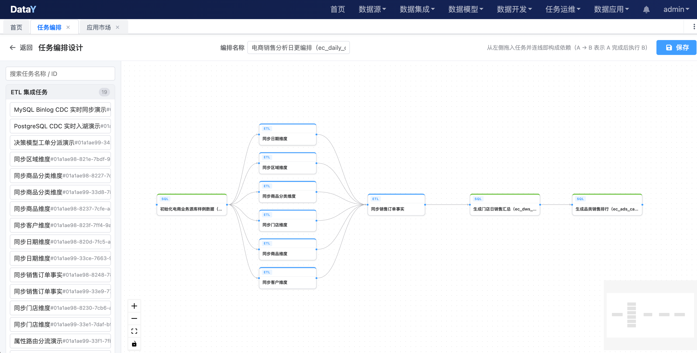

# 任务能跑，不等于流程能跑：DataY 任务编排，把 ETL、SQL、Shell 串成一条可靠的流水线

> 一张画布，定义任务之间的先后关系；
> 一次拓扑排序，决定谁先跑、谁后跑；
> 一套实例状态，让每一次运行都可解释、可复现、可追踪。

---

凌晨两点，订单同步任务跑完了。

你打开监控看了一眼：绿色的，成功了。

但第二天早上，业务同学还是找上门来：

> “昨天的日报，销售额怎么还是前天的数？”

继续往下查，问题往往不是某一个任务失败，而是**任务之间的顺序乱了**：

- 订单同步跑完了，但商品维度还没更新；
- 商品维度更新了，但汇总 SQL 已经提前跑完；
- 汇总 SQL 失败了，下游的报表任务却照常启动；
- 某个任务中途挂了，剩下几个任务没人知道该不该跑；
- 最后只能打开终端，手动一个个补。

单看每个任务，都是成功的。

合在一起，整条链路却是断的。

**这就是“任务能跑”和“流程能跑”的区别。**

DataY 的**任务编排**，解决的正是这个问题：它不要求你写一堆 `sleep`、`&&` 和补数脚本，而是把已经建好的 ETL、SQL、Shell 任务拖到一张画布上，用连线表达依赖，剩下的交给调度引擎。

---

## 01 你缺的可能不是任务，而是任务之间的关系

大多数团队刚做数据开发时，任务是这样组织的：

```text
02:00  同步订单表
02:10  同步商品表
02:20  清洗订单明细
02:30  生成销售汇总
02:40  刷新报表
```

看起来井井有条，实际上每一个时间点都是**人估算出来的**。

只要有一个任务变慢，后面的时间假设就全部失效。

于是就会出现几种典型的“土办法”：

**第一种：把依赖写进脚本。**

```bash
python sync_order.py && python sync_product.py && python build_summary.py
```

能跑，但任何一个环节失败，整条链路就停在半路；想看某个步骤的日志，只能去翻终端输出。

**第二种：用 `sleep` 等一等。**

```bash
python sync_order.py
sleep 600
python build_summary.py
```

上游实际跑了 3 分钟，你等了 10 分钟；上游跑了 20 分钟，下游照样提前启动。

**第三种：靠人盯。**

每天定时打开页面，看上一个任务绿了，再手动点下一个。

任务少的时候还能应付；任务一多，值班同学就成了“人肉调度器”。

问题的本质不是任务不够多，而是：

> **任务之间缺少一层显式的关系描述。**

谁是上游，谁是下游，上游失败了下游还要不要跑，失败了要不要重试，超时了怎么停，跑完去哪里看日志——这些信息如果只存在于人的脑子里，流程就永远是脆弱的。

---

## 02 任务编排，是给任务补上“关系层”

DataY 的任务类型里，有一个专门的 **DAG（有向无环图）** 类型。

它不是一种新的数据集成任务，也不是一段新的 SQL，而是**已有任务之间的关系层**。

一个编排任务由三部分组成：

- **节点**：引用已经创建好的 ETL、SQL、Shell 等任务；
- **连线**：表达“谁先执行、谁后执行”；
- **布局**：记录节点在画布上的位置，方便下次打开继续编辑。

也就是说，你不需要把 ETL 的配置、SQL 的脚本再抄一遍。编排里存的是任务的 ID，执行时仍然复用原来的任务定义。

这带来一个很实际的好处：

> **任务只有一份定义，编排只是引用它。**

修改 SQL 只需要改原来的 SQL 任务；调整 ETL 的字段映射，也只需要改 ETL 本身。所有引用它的编排，下次运行时自动使用最新配置。

在 DataY 里，这三类东西可以简单区分：

| 概念 | 回答的问题 | 典型入口 |
| --- | --- | --- |
| 任务 | “具体要做什么？” | 任务定义 / ETL 设计 |
| 编排 | “这些任务按什么顺序做？” | 任务编排（DAG） |
| 调度 | “什么时候开始做？” | Cron、上线 / 下线、依赖调度 |

任务编排负责“关系”，调度负责“时间”。

两者组合起来，才是一条完整的流水线。

这里要特别区分两种“DAG”：

- **ETL 画布里的 DAG**：节点是组件（输入、SQL、输出），描述数据怎么流；
- **任务编排里的 DAG**：节点是任务（ETL、SQL、Shell），描述任务什么时候跑。

前者是“数据流编排”，后者是“任务流编排”。

DataY 把这两层分开，是因为它们的变化频率不一样：数据流通常由数据开发维护，任务顺序则由整个链路的生产节奏决定。

---

## 03 三步，把一条流水线搭起来

DataY 的任务编排是可视化画布，操作路径很短。

### 第一步：先把“点”准备好

在「任务定义」里创建好需要被编排的任务：

- **ETL**：数据同步、清洗、写入；
- **SQL**：在指定数据源上执行 SQL 脚本；
- **Shell**：执行脚本或调用外部命令；
- **DEMO**：用于演示和验证流程。

每个任务都有独立的配置、重试次数、超时时间和优先级。

编排不关心任务内部怎么实现，只关心它什么时候该跑。

### 第二步：把任务拖进画布，连成“线”

进入「数据开发 → 任务编排」，点击「新建编排」。

左侧会按任务类型分组列出所有可编排的任务，支持按任务名称或 ID 搜索。

把任务拖到画布上，再从上游节点拉一条线到下游节点：

```text
订单同步  ──▶  订单明细清洗  ──▶  销售汇总  ──▶  日报刷新
```



> 一张真实的任务编排画布：从初始化源数据，到同步多个维度、同步订单事实，再到生成日汇总与品类排行。画布上看似并行的分支，执行时会按拓扑序依次推进。

连线的含义很直接：

> **A → B，表示 A 成功执行完之后，才执行 B。**

设计器会在连线时做环检测。如果一条线会让流程形成循环依赖，会直接提示：

> “连线会形成环，DAG 不允许存在循环依赖。”

保存前还会再校验一次，避免把不合法的流程带到执行阶段。

双击节点，可以查看被引用任务的详情：类型、状态、Cron、任务配置。确认自己没有连错任务。

### 第三步：先手动跑一次，再上线

编排保存后，默认是 `OFFLINE` 状态。

建议先点「立即执行」，手动跑一次完整流程，确认：

- 节点顺序符合预期；
- 每个任务的配置正确；
- 下游能拿到上游的结果；
- 日志里没有隐藏的错误。

确认无误后，再点「上线」。

上线时会弹出调度配置，可以设置：

- **Cron 表达式**：例如每天凌晨 2 点；
- **重试次数**：失败后最多重试几次；
- **超时时间**：单次执行超过多久自动停止；
- **优先级**：低 / 中 / 高。

只有上线的编排，才会按 Cron 自动触发。

上线后，编排会出现在任务编排列表中，可以随时「下线」取消定时调度，也可以再次「立即执行」做临时补跑。

---

## 04 执行时，DataY 到底做了什么？

画布上看到的是节点和连线，落到执行层，是一张有向无环图。

当一次编排被触发时，DataY 会做几件事。

### 1. 为每个节点创建子任务实例

编排本身会生成一个父实例。

然后，编排引用的每个任务都会生成一个子任务实例，并记录：

- 所属的父实例编码；
- 子任务自己的实例编码；
- 任务类型、任务名称；
- 初始状态 `APPENDING`；
- 继承自父编排的优先级。

这样做的好处是：**一次编排运行，可以拆开看每个节点的执行情况。**

不是只看一个“编排成功/失败”，而是能看到每一步到底跑了多久、在哪台机器上跑、输出了什么日志。

### 2. 用拓扑排序决定执行顺序

DataY 使用 Guava 的 `MutableGraph` 构建依赖图，再用 Kahn 算法做拓扑排序：

1. 把所有子任务加入图；
2. 根据依赖关系添加有向边；
3. 计算每个节点的入度；
4. 入度为 0 的节点先进入执行队列；
5. 每执行完一个节点，后继节点入度减一；
6. 入度减到 0 的节点，进入下一轮执行。

拓扑排序保证了一件事：

> **任何一个节点，都会在它所有的上游节点成功之后才执行。**

比如这样一张图：

```text
        ┌──▶ 商品维度 ──┐
订单同步 ─┤               ├──▶ 销售汇总 ──▶ 日报
        └──▶ 门店维度 ──┘
```

订单同步一定先于商品维度和门店维度；商品维度、门店维度一定先于销售汇总；销售汇总一定先于日报。

### 3. 当前版本：按拓扑序串行推进

这里需要说清楚一个边界：

> **DataY 当前的 DAG 子任务，是在一个 Worker 上按拓扑序串行执行的。**

也就是说，商品维度和门店维度虽然互不依赖，但当前版本不会把它们拆到两个 Worker 上并行跑，而是按拓扑排序的结果依次推进。

代码里预留了“按层并行”的优化点，但当前版本没有做跨节点 DAG 分片。

这不是“已经支持但没写”，而是一个明确的取舍：

- 串行执行更容易保证状态一致；
- 一个编排只占用一个 Worker 线程；
- 对几十到几百个任务的中小团队来说，已经够用；
- 如果确实需要并行，可以把互不依赖的链路拆成多个编排，分别调度。

比起“看起来支持并行、实际状态很难收敛”，我们更愿意把边界写清楚。

### 4. 上游失败，下游不再执行

如果某个子任务返回非成功状态，编排会立即停止后续节点的执行。

不仅如此，尚未执行的节点会被统一标记为 `INTERRUPTED`，而不是留在 `APPENDING` 或 `RUNNING` 状态里“悬空”。

这样一次失败的编排，最终状态是完整的：

```text
订单同步       SUCCESSFUL
商品维度       SUCCESSFUL
门店维度       FAILED
销售汇总       INTERRUPTED
日报           INTERRUPTED
```

你一眼就能看出：问题出在门店维度，销售汇总和日报不是“没跑”，而是“因为上游失败被中断”。

---

## 05 编排跑完，去哪里看？

任务编排最容易踩的坑，是“失败了但不知道为什么”。

DataY 在实例层做了两层记录。

### 第一层：编排实例

在「任务实例」里，可以看到每次编排的父实例：

- 实例状态：`APPENDING` / `RUNNING` / `WAITING` / `SUCCESSFUL` / `FAILED` / `TIMEOUT` / `INTERRUPTED`；
- 执行节点：`IP:端口`；
- 开始时间、结束时间；
- 执行消息；
- 支持停止正在运行的实例。

### 第二层：子任务实例

点开一个 DAG 编排实例的日志，看到的不是一大段混在一起的输出，而是**按子任务分组**的折叠面板。

每个子任务独立展示：

- 子任务状态；
- 任务名称和类型；
- 开始 / 结束时间；
- 该子任务自己的日志。

哪一步慢了、哪一步报错了，直接展开对应节点即可。

这比“把所有日志写进一个文件，再靠关键字搜索”要直观得多。

---

## 06 失败之后：重试、超时、停止、告警

编排不是为了“一次跑成功”，而是为了“失败时知道怎么收场”。

DataY 在任务实例上提供了统一的执行支撑。

### 重试

`retryCount` 表示首次执行之外的最大重试次数：

- 默认 0，表示不重试；
- 最多 10 次；
- 重试间隔默认 10 秒；
- 只有 `FAILED` 和 `TIMEOUT` 会自动重试；
- 手动停止的 `INTERRUPTED` 不会重试；
- 成功的任务不会重试。

对于 DAG 编排，重试的语义是：

> **整体重跑所有子任务。**

代码里不会去查子任务的历史状态，避免出现“上一次跑到一半，这一次以为已经完成”的问题。

这也意味着：**编排里的任务需要尽量幂等。**

同样的数据写两次，结果应该一致；否则重试可能带来重复数据。

### 超时

`timeoutSeconds` 表示单次尝试的超时时间：

- 0 表示不限制；
- 最大 7 天；
- 每次尝试单独计时；
- 超时后，看门狗线程会取消任务并中断执行线程；
- 最终状态记为 `TIMEOUT`。

一个卡死的任务，不应该无限期占着 Worker 线程。

### 停止

运行中的编排支持手动停止。

停止不是简单地把状态改成“失败”，而是一条完整的回收链路：

1. 标记停止请求；
2. 调用当前任务的 `cancel()`；
3. 取消执行 Future，中断线程；
4. 当前子任务及尚未执行的子任务标记为 `INTERRUPTED`。

停止之后，实例状态是明确的，不会留下“看起来还在跑”的僵尸任务。

### 告警

任务最终状态为 `FAILED` 或 `TIMEOUT` 时，告警中心会生成告警事件。

对于 DAG：

- **只对顶层编排告警**；
- 子任务失败由父编排统一告警，子任务不单独产生告警；
- 告警内容包含任务名称、实例编码、执行节点、开始 / 结束时间；
- 失败 / 超时告警会附带错误日志摘要。

通知渠道支持：

- **站内信**：内置，开箱可用；
- **邮件**：需要配置 SMTP；
- **Webhook**：可以对接企业微信、钉钉、飞书机器人或自建告警平台。

编排上线之后，告警是最后一道防线。

没有告警的编排，只能靠人每天早上去看“昨天跑没跑”。

---

## 07 定时与依赖：两种编排方式

DataY 里有两个层次的“编排”。

### 1. 编排内部的 DAG

就是前面说的任务编排画布：

- 节点是任务；
- 连线是依赖；
- 拓扑排序决定顺序；
- 一次触发，按顺序跑完整个流程。

适合表达一条完整的业务流水线，例如：

```text
ODS 同步 → DWD 清洗 → DWS 汇总 → ADS 报表
```

### 2. 任务之间的依赖（JobDepend）

除了 DAG 内部，DataY 也支持任务与任务之间的父子依赖。

子任务触发时，会检查它依赖的父任务：

- 父任务最近一次成功实例是否存在；
- 父实例的时间与当前实例的间隔是否在 `lastInterval` 窗口内；
- 满足才执行，不满足则进入 `WAITING`。

等待中的实例由后台任务每分钟扫描一次，依赖满足后自动恢复执行。

同一任务产生新的等待实例时，旧的等待实例会被置为 `TIMEOUT`，避免无限堆积。

这里有一个容易踩的坑：

> `lastInterval` 的单位是**毫秒**，不是分钟，也不是小时。

如果窗口设置成 0，父任务的成功实例几乎永远不满足“在 0 毫秒内成功”，子任务就会一直停在 `WAITING`。

所以我们的建议是：

- **复杂流程优先用 DAG 编排表达**，依赖关系更直观，执行顺序由拓扑排序保证；
- 跨任务的轻量串联再用 `JobDepend`；
- 如果用了 `JobDepend`，一定要把 `lastInterval` 设置成符合业务节奏的窗口。

---

## 08 从单机到集群，编排不用换一套系统

任务编排最终要落到调度和执行上。

DataY 的调度系统由 **master（调度）** 和 **worker（执行）** 两类角色组成，通过 `development.mode` 配置：

| 模式 | 调度能力 | 执行能力 | 依赖 Redis | 适用场景 |
| --- | --- | --- | --- | --- |
| `standalone` | 有 | 有 | 否 | 单机、开发、边缘节点 |
| `master` | 有 | 无 | 是 | 只做调度，可多副本 |
| `worker` | 无 | 有 | 是 | 只做执行，水平扩展 |
| `master,worker` | 有 | 有 | 是 | 小集群，调度与执行同机 |

几个关键点：

- `standalone` 是默认值，**单机不需要 Redis**；
- 需要扩容时，改一个配置就能拆成 master / worker；
- 单机和集群是同一套代码，不是两个版本；
- 多 master 部署时，通过 Redis 分布式锁做 Leader 选举，只有 Leader 负责调度。

启动也很直接：

```bash
# 单机（默认，无需 Redis）
java -jar datay-web.jar

# 只做调度
java -jar datay-web.jar --development.mode=master

# 只做执行
java -jar datay-web.jar --development.mode=worker

# 调度 + 执行同机
java -jar datay-web.jar --development.mode=master,worker
```

对小团队来说，这意味着：

> **第一天用一个 JAR 跑起来，等任务真的多了，再改配置扩容。**

而不是第一天就按“大厂架构”部署一套集群。

### 一个容量提醒

Worker 的默认配置是：

| 配置项 | 默认值 | 说明 |
| --- | --- | --- |
| `development.worker.thread-count` | 50 | 单节点同时执行的任务数上限 |
| `development.worker.queue-capacity` | 50 | 待执行队列容量 |
| `development.scheduler.thread-count` | 10 | Quartz 触发线程数 |

因为一个 DAG 编排会在一个 Worker 线程里串行推进所有子任务，所以：

> **一个正在运行的编排，占用一个 Worker 线程。**

如果你有大量编排同时运行，需要按“同时运行的编排数”来估算 Worker 线程数，而不是按“子任务总数”估算。

任务真的很多时，可以：

- 增加 Worker 副本；
- 调整 `development.worker.thread-count`；
- 把互相独立的链路拆成多个编排；
- 对 ETL 任务使用 Docker 执行模式，把运行时与调度进程隔离。

---

## 09 编排也可以是一条“可搬运的资产”

DataY 的资产包支持把编排任务和相关子任务一起打包。

导出时会自动带上：

- 编排引用的 ETL、SQL、Shell 任务；
- 编排本身；
- 任务之间的依赖关系。

导入到另一个租户或环境时，平台会自动完成 ID 替换，不需要手工重新连一遍线。

这对“开发环境搭好、生产环境再建一遍”的场景很有用：

> **编排不只是画布上的图，也可以作为一套可交付的数据资产。**

---

## 10 什么场景适合任务编排？

任务编排最适合“有明确先后关系、需要整体交付”的流程。

### 适合

- 每天 / 每小时的数据同步 + 清洗 + 汇总；
- 上游成功后才允许下游执行；
- 一次失败要能定位到具体节点；
- 需要统一重试、超时、告警；
- 需要把多个任务作为一个整体上线、下线、补跑。

例如：

```text
MySQL 订单同步
      ↓
DWD 订单明细清洗
      ↓
DWS 销售汇总
      ↓
ADS 日报表
      ↓
数据质量校验
```

### 不太适合

- **需要大量并行分支的复杂工作流**：当前版本按拓扑序串行推进，不跨 Worker 并行；
- **动态分支 / 条件流转**：例如“金额大于 100 万走审批，否则直接入账”；
- **嵌套编排 / 循环子流程 / 任意事件驱动编排**：当前只覆盖常见的 Cron + DAG + 父子依赖；
- **严格 Exactly-Once 的调度语义**：调度触发可以做到尽量不重复，但任务执行的幂等仍需业务保证；
- **Worker 进程级故障的自动接管**：任务正常失败会重试，但 Worker 直接宕机后实例可能停留在 `RUNNING`，需要人工重跑或后续补偿。

把边界说清楚，比把能力说满更重要。

---

## 11 五个实践建议

如果你准备在 DataY 里落地任务编排，这几条经验可以少踩坑。

### 1. 一条编排，对应一条业务链路

不要把所有任务都塞进一个巨大的 DAG。

推荐按业务域拆分：

```text
订单日更编排
商品日更编排
库存小时级编排
```

编排越聚焦，失败影响面越小，排查也越快。

### 2. 节点 name 要能一眼看懂

编排画布上显示的是任务名称。

建议用“动词 + 对象”的方式命名：

```text
同步订单表
清洗订单明细
生成销售汇总
刷新日报
```

不要用 `task_001`、`sql_2` 这种名字。

### 3. 先手动跑，再上线

新编排上线前，至少手动执行一次。

重点检查：

- 拓扑顺序是否符合预期；
- 上游产出的表 / 分区下游能不能读到；
- 失败时下游是否真的被中断；
- 日志是否能定位到具体节点。

### 4. 给关键节点设置超时

没有超时的任务，一旦卡死，会一直占着 Worker 线程。

建议根据历史执行时间设置一个合理上限，例如：

```text
日常 5 分钟的任务，超时设为 30 分钟
```

### 5. 幂等是重试的前提

编排重试会整体重跑所有子任务。

所以每个节点都要尽量做到：

- 重复写入不产生重复数据；
- 重复执行结果一致；
- 能按分区 / 主键覆盖，而不是无脑追加。

---

## 12 写在最后

任务编排的价值，不是把画布拉得漂亮。

而是让一条数据链路具备三个能力：

- **可解释**：为什么这个任务先跑，那个任务后跑；
- **可复现**：同样的配置，今天和明天跑出来的顺序一致；
- **可追踪**：失败在哪一步、哪台机器、什么原因。

DataY 做的，是把这三件事收进一个轻量平台：

- 用画布表达依赖；
- 用拓扑排序保证顺序；
- 用实例状态记录每一次运行；
- 用重试、超时、停止、告警兜住失败；
- 用 `standalone` / `master` / `worker` 支撑从单机到集群的演进。

如果你现在还在用 `sleep` 和手动点按钮串任务，不妨试试把它画成一张 DAG。

**任务能跑，是起点；流程能跑，才是生产。**

---

## 快速开始

```bash
# 下载运行包
wget https://datay.yuyuejia.com.cn/download/datay-web.jar -O datay-web.jar

# 启动（单机模式，调度 + 执行合一）
java -jar datay-web.jar --DATAY_AI_API_KEY=sk-xxxxxxxxx

# 浏览器打开 http://localhost:8080
# 默认账号：admin / admin
```

从源码构建：

```bash
git clone https://gitee.com/yuyuejia/datay.git
cd datay
mvn clean package -DskipTests
java -jar datay-web/target/*.jar --DATAY_AI_API_KEY=sk-xxxxxxxxx
```

- 产品首页：<http://datay.yuyuejia.com.cn/>
- 在线体验：<http://datay-demo.yuyuejia.com.cn/>
- 项目地址：<https://github.com/yuyuejia/datay>
- 使用文档：<http://datay.yuyuejia.com.cn/help/>

---

> **DataY**：一个 JAR、自研流批数据处理、自研分布式调度，2 核 4G 就能跑通「数据集成 → 数据建模 → 数据开发 → 任务调度 → 数据应用」的完整链路。
