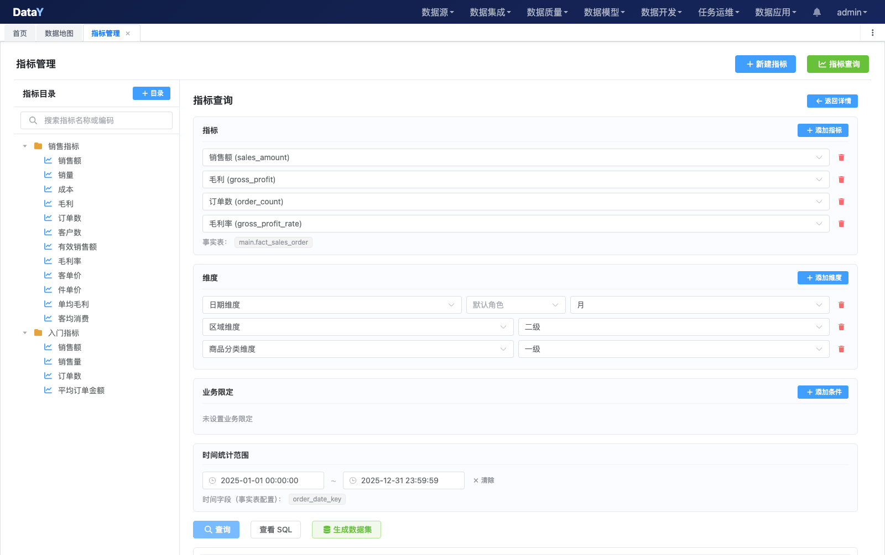
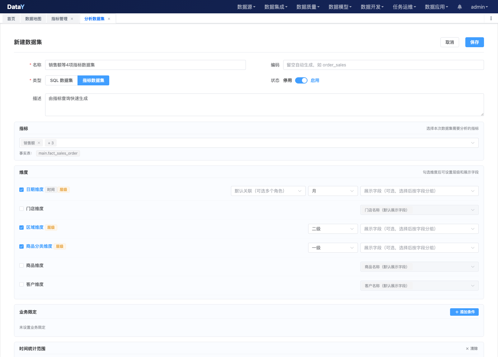
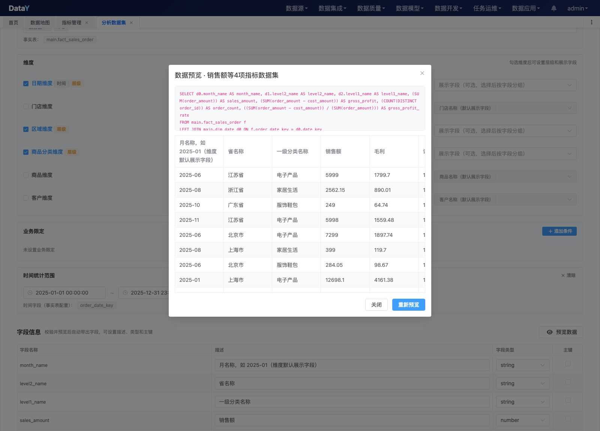
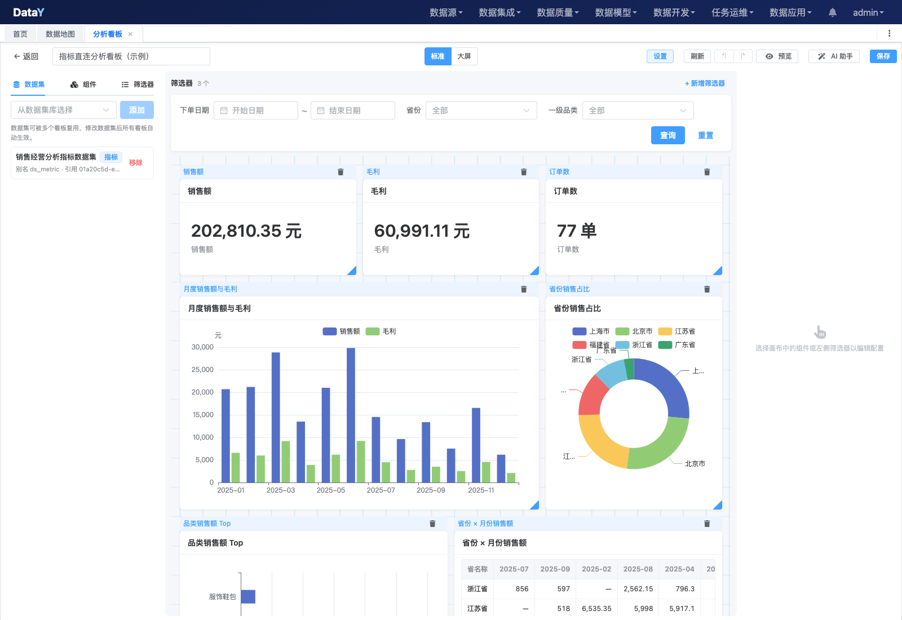

# 打通指标应用的最后一公里：让分析看板直接「吃」指标

> 指标建了几百个，看板还在写 SQL。
>
> 口径治理做了很久，最后一百米仍然靠人肉翻译。
>
> 真正缺的往往不是指标，而是把指标「可执行」地交给分析。

---

## 01｜一个熟悉的早上：指标平台和看板，各算各的

周一早上九点，经营分析会。

大屏上，上月销售额是 **1268 万**；财务打开指标平台，同一个「销售额」是 **1204 万**。

两边都没有算错。

大屏的 SQL 把退款订单算了进去，指标平台里的「销售额」则明确排除了退款；大屏按支付时间统计，指标平台按收货时间统计。于是会议暂停二十分钟，开始对数。

这个场景几乎每家公司都遇到过。它看起来是数据问题，实际上是**应用链路**问题：

```text
指标定义  →  指标平台  →  ？？？  →  分析看板
                              ↑
                        最后一公里断在这里
```

过去几年，很多团队已经把「指标管理」做起来了：

- 有指标目录，能按业务域查找；
- 有原子指标、衍生指标，公式可维护；
- 有业务限定、时间周期、数据权限；
- 有指标血缘，能追溯上游模型和下游应用。

但到了分析看板，链路突然换了一套：

- 看板不引用指标，而是重新写 SQL；
- 每做一个看板，就把指标口径复制一遍；
- 指标平台改了公式，看板不会自动更新；
- 同一个「销售额」，在五个看板里有五种写法。

**指标管理的 0 → 1 已经完成，1 → N 还没有。**

这个 1 → N，就是指标应用的最后一公里。

---

## 02｜最后一公里，到底卡在哪

很多团队以为，最后一公里是「可视化」：图表不够多、大屏不够炫、拖拽不够顺。

但真正卡住分析的，通常不是画图，而是**取数**。

业务想问的是：

> 「华东、家电品类，最近三个月销售额和毛利怎么样？」

平台要的是：

> 指标编码 + 事实表 + 维度字段 + 聚合方式 + 业务限定 + 时间范围 + 数据权限。

中间这层翻译，目前常见的做法有三种，各有各的问题。

| 做法 | 指标定义在哪 | 看板怎么取数 | 结果 |
| --- | --- | --- | --- |
| 指标只做文档 / 字典 | 文档、指标平台 | 分析人员手写 SQL | 口径靠自觉，看板各写各的 |
| 指标 API 返回固定结果 | 接口 | 只能看接口固定的粒度和字段 | 不灵活，换个维度就要改接口 |
| 看板里内嵌指标 SQL | 每个看板 | 复制一份 SQL 再改 | 指标平台管不到，越用越分叉 |
| **指标数据集** | **指标平台** | **引用数据集，运行时生成查询** | **统一、灵活、可治理** |

前三种做法，本质上都没有把指标变成一种**可复用的查询能力**。

- 文档不可执行；
- 固定 API 不可切维度；
- 内嵌 SQL 不可治理。

所以问题不是「指标不够多」，而是「指标不能被看板直接消费」。

---

## 03｜DataY 的答案：指标数据集，指标到看板的「标准插头」

DataY 在指标管理和分析看板之间，加了一层：**指标数据集**。

它不是一张固定的结果表，也不是一段写死的 SQL，而是一份**可复用的查询契约**：

```text
指标数据集 =
  指标（算什么）
  + 维度（从哪些角度观察）
  + 业务限定（口径里固定要过滤什么）
  + 时间范围（默认统计哪段）
  + 字段元数据（给看板选字段用的列信息）
```

在 DataY 里，这三层职责是分开的：

| 层 | 负责什么 | 不负责什么 |
| --- | --- | --- |
| **指标管理** | 指标公式、业务限定、指标口径 | 不决定某个看板怎么看 |
| **指标数据集** | 这组分析可用哪些指标、维度和默认时间范围 | 不决定图表长什么样 |
| **分析看板** | 图表、布局、筛选器、交互 | 不重新定义指标口径 |

这样分层之后，看板设计器里看到的每一个字段，都不是「猜出来的列名」，而是指标平台里真实存在的指标和维度。

更关键的是：**通过数据集库引用时，看板只保存数据集 id，不保存指标定义，也不内嵌 SQL。**

```json
{
  "datasets": [
    {
      "id": "ds_metric",
      "refId": "01a20c5d-e58e-7146-84db-0fab11d26feb",
      "name": "销售经营分析指标数据集",
      "type": "METRIC"
    }
  ]
}
```

查询时，服务端再根据 `refId` 读取数据集的最新定义。

这意味着：

- 指标公式改了，所有引用它的看板一起生效；
- 数据集补了一个维度，多个看板都能用；
- 口径只有一个来源，不再靠「复制 SQL 时小心一点」。

---

## 04｜三步：从指标到看板，不写一行 SQL

下面用 DataY 里的一组电商指标，完整走一遍。

### 第一步：在指标查询里，把分析范围定下来

进入 **数据模型 → 指标管理 → 指标查询**。

选择本次分析要用的指标：

- 销售额 `sales_amount`
- 毛利 `gross_profit`
- 订单数 `order_count`
- 毛利率 `gross_profit_rate`

再添加维度：

- 日期维度，按月；
- 区域维度，按省；
- 商品分类维度，按一级品类。

最后设置时间统计范围，例如 `2025-01-01 ~ 2025-12-31`。



*图：指标查询页面，选好指标、维度和时间范围后，可以直接「生成数据集」*

这里的「业务限定」和看板上的「筛选器」不是一回事：

- **业务限定**属于指标口径，比如「只算已支付订单」，应该沉淀在指标或数据集里；
- **筛选器**属于分析上下文，比如「只看江苏省」，应该由看板运行时传入。

把这两类条件混在一起，是口径失控的常见起点。

### 第二步：确认数据集，预览字段和数据

点击「生成数据集」，会跳到数据集编辑器。

在这里可以继续调整：

- 数据集名称、编码、描述；
- 包含哪些指标；
- 勾选哪些维度、层级和展示字段；
- 业务限定；
- 默认时间范围。

点「预览数据」，平台会先校验定义，再执行一次真实查询，同时带出字段信息。



*图：指标数据集编辑器，指标、维度、业务限定、时间范围都在这里沉淀*



*图：预览会显示运行时生成的 SQL、结果数据和字段元数据*

注意预览弹窗里的 SQL。它不是提前写死的，而是根据指标公式和维度实时生成的：

```sql
SELECT
  d0.month_name AS month_name,
  d1.level2_name AS level2_name,
  d2.level1_name AS level1_name,
  SUM(f.order_amount) AS sales_amount,
  SUM(f.order_amount - f.cost_amount) AS gross_profit,
  COUNT(DISTINCT f.order_id) AS order_count,
  SUM(f.order_amount - f.cost_amount) / SUM(f.order_amount) AS gross_profit_rate
FROM main.fact_sales_order f
LEFT JOIN main.dim_date d0 ON f.order_date_key = d0.date_key
LEFT JOIN main.dim_region d1 ON f.region_key = d1.member_id
LEFT JOIN main.dim_category d2 ON f.category_key = d2.member_id
WHERE f.order_date_key BETWEEN ... AND ...
GROUP BY d0.month_id, d0.month_name,
         d1.level2_id, d1.level2_name,
         d2.level1_id, d2.level1_name
```

毛利率不是把每一行的毛利率再求平均，而是用**总毛利 / 总销售额**重新计算。这个细节决定了「比率型指标」在看板上会不会越汇总越离谱。

预览确认无误后，保存数据集。到这里，指标已经变成了一个可被复用的分析数据源。

### 第三步：在看板设计器里，直接引用指标数据集

进入 **数据应用 → 分析看板 → 看板设计**。

左侧「数据集」面板里，从数据集库选择刚刚保存的「销售经营分析指标数据集」，标签会显示为「指标」。

接下来就是正常的看板设计：

- KPI 卡直接选 `sales_amount`、`gross_profit`、`order_count`；
- 趋势图选 `month_name` 做横轴，销售额和毛利做系列；
- 省份占比选 `level2_name` 做分类，销售额做数值；
- 透视表用 `level2_name` 做行、`month_name` 做列；
- 筛选器绑定「指标时间范围」、省份、一级品类。



*图：看板左侧直接引用指标数据集，KPI、图表、透视表都使用同一份指标定义*

整个过程没有写一行 SQL。

但「没有写 SQL」不是重点。重点是：**看板上的每个数字，都能回到指标平台里的同一条公式。**

---

## 05｜看板里的每个图，都是同一份指标定义

这张看板里，KPI、柱状图、环形图、透视表和明细表，引用的都是同一个 `ds_metric`。

它们不是五份 SQL，而是同一份指标数据集的不同「切法」。

- KPI 卡：不分组，直接取指标汇总值；
- 月度趋势：按 `month_name` 分组，取销售额和毛利；
- 省份占比：按 `level2_name` 分组，取销售额；
- 透视表：按省份和月份交叉分组；
- 明细表：按数据集输出字段展示。

当业务在筛选器里选择「江苏省」时，这个条件会被服务端解析成指标查询里的维度过滤，而不是前端拿到全量数据后再过滤。

当业务把时间范围改成「最近 30 天」时，日期筛选器会下推到指标的**事实表时间字段**，而不是对一个已经聚合好的结果再做一次日期过滤。

这就是「直接使用指标」和「把指标结果做成一张宽表」的区别：

| 对比项 | 指标结果宽表 | 指标数据集 |
| --- | --- | --- |
| 保存内容 | 某个时间点跑出来的固定结果 | 指标 + 维度 + 限定 + 时间范围的查询契约 |
| 换维度 | 重新跑表、改表结构 | 数据集里加维度，看板直接选 |
| 换时间范围 | 重新产出结果 | 运行时下推，即时查询 |
| 比率型指标 | 容易对比率再平均 | 分子分母重新聚合 |
| 数据量 | 维度组合爆炸，宽表越来越大 | 按查询聚合，不落地全量组合 |
| 口径变更 | 改 ETL、改表、改看板 | 改指标公式，引用方自动生效 |
| 权限 | 依赖表权限或视图 | 指标维度权限 + 数据集行级权限 |

指标数据集保存的是「按什么口径、从什么角度算」，不是「算完的结果」。

这两者看起来只差一个字，维护成本差一个数量级。

---

## 06｜看板这一端，做了哪些「真能用」的工程

只把指标接进看板还不够。真正上线后，看板还要面对筛选、聚合、权限、性能和口径变更。

DataY 在看板查询链路上做了几件事。

### 1. 筛选器统一由服务端执行

看板筛选器不是前端本地过滤。

- 指标数据集的直接字段，会解析成维度过滤条件；
- 日期范围可以绑定「指标时间范围」，下推到事实表时间字段；
- 维度、事实字段、SQL 参数都有对应的下推方式；
- 前端只把筛选值发给服务端，不拿着全量数据做本地过滤。

这样做的好处很直接：页面看到的结果、导出的结果、API 返回的结果，是同一套查询逻辑。

### 2. 分组、聚合、排序、Top N 尽量下推

图表开启 `groupBy` 后，分组字段、聚合方式、排序和 `limit` 会一起下推到数据库。

透视表直接按行、列、值聚合，不需要先把全量明细拉到前端。

服务端完成聚合后返回 `aggregated: true`，前端不会再做一次聚合，避免 `avg`、`count` 这类指标被二次计算。

### 3. 权限在服务端拼进查询

指标数据集会同时受到两类权限约束：

- **指标维度权限**：按角色限制能看到哪些维度成员，比如华东经理只能看华东；
- **数据集行级权限**：按角色限制数据集输出行，比如某部门只能看本部门数据。

两类权限都在服务端拼进查询，前端改参数绕不过去。

同一个看板，不同角色打开看到不同的数据范围，但口径仍然是同一套。

### 4. 已保存看板有查询缓存

已保存看板的批量查询结果有 30 秒内存缓存、最多 256 条、LRU 淘汰。

筛选值或查询条件变化时才重新请求；设计页的预览不缓存，避免未保存草稿互相污染。

### 5. 数据量大时，可以物化

指标数据集默认是实时查询。数据量大、并发高、或者看板需要稳定响应时，可以把数据集结果物化到目标表，并按 Cron 调度更新。

看板查询会优先读取物化结果；结果不可用或条件无法下推时，再回退实时查询。

这不是必须的，但它给「口径统一」和「查询性能」之间留了一个可调的档位。

### 6. 指标变更后，能顺着血缘找到看板

指标详情页的「数据血缘」会展示下游引用它的看板。

改公式之前，可以先看清影响范围；改完之后，所有引用该指标的看板在缓存过期后自动使用新口径。

治理不再靠「谁知道这个指标被哪些报表用了」。

### 7. AI 看板助手，也走同一条链路

AI 看板助手不会在看板里内嵌一套自己的指标 SQL。

它先通过工具查数据集、准备指标数据集，再生成看板定义；最终写入 spec 的仍然是数据集引用。

也就是说，AI 生成和人工设计，消费的是同一套指标口径。

---

## 07｜边界：什么时候仍然该用 SQL 数据集

指标数据集不是要取代 SQL。

它解决的是「已经沉淀为指标的、需要被反复分析和复用的查询」。下面这些场景，SQL 数据集仍然更合适：

- 一次性的探索分析，还没有形成稳定指标；
- 复杂的窗口函数、留存、路径分析等非标准指标逻辑；
- 外部系统已经有一份成熟 SQL，只需要接进来看板；
- 某些跨多源、跨粒度的特殊合并，指标模型暂时覆盖不了。

DataY 的数据集本来就支持两种类型：

| 类型 | 适合什么 | 例子 |
| --- | --- | --- |
| **指标数据集** | 口径稳定、需要多维分析、要被多个看板复用 | 销售额、毛利、订单数、毛利率 |
| **SQL 数据集** | 临时探索、复杂逻辑、已有 SQL 资产 | 留存 cohort、路径分析、外部报表 SQL |

判断标准不是「哪种更高级」，而是：

> **这个数会不会被反复问？它的口径要不要被治理？**

会，就用指标数据集；不会，就用 SQL 数据集先跑起来。

---

## 08｜几个落地建议

如果你准备在自己的环境里用指标数据集，下面几条经验可以少走弯路。

### 1. 一个看板尽量复用一个指标数据集

不要为每个图表建一个数据集。

同一个看板里的 KPI、趋势、占比、透视表，优先共享同一个指标数据集的不同字段和不同分组。这样口径最统一，维护也最轻。

### 2. 维度不是越多越好

指标数据集里的维度，决定了看板能切的分析角度。

建议放「业务最常用的下钻路径」：时间、区域、品类、渠道、门店。不要把几十个维度全部塞进去，否则数据集会变重，看板字段也会难找。

### 3. 业务限定放指标，筛选器放看板

- 「只算已支付订单」：业务限定，属于口径；
- 「只看江苏省」：筛选器，属于本次分析。

两者混用，短期看只是多了一个条件，长期看会让指标口径失去稳定性。

### 4. 日期筛选优先绑定「指标时间范围」

指标数据集的时间字段来自事实表配置。

日期筛选器绑定「指标时间范围（事实表时间）」后，条件会在指标查询内部下推，而不是对结果列做二次过滤。这样既准确，也更容易命中索引。

### 5. 大屏和高并发场景，提前评估物化

实时查询适合交互式分析；大屏、高频刷新、超大事实表，建议评估物化结果表。

物化不是「另一套口径」，而是同一份指标数据集的预计算结果。

### 6. 指标变更前，先看看板血缘

指标详情页能看下游看板。改公式之前先确认影响范围，比上线后被动对数更省时间。

---

## 09｜写在最后：指标不是文档，是能力

很多团队做指标管理，做着做着就做成了一个「指标字典」：

- 有名称、有编码、有公式、有负责人；
- 但业务想看数，还是得提需求、写 SQL、做看板。

这不是指标管理失败，而是指标只完成了「被定义」，还没有完成「被使用」。

指标应用的最后一公里，不是把图做得更漂亮，而是：

> 业务在问「为什么」的时候，随手切一个维度、换一个时间范围，
>
> 得到的仍然是同一套口径。

DataY 用「指标数据集」把这段链路接了起来：

```text
指标定义
   ↓
指标数据集（指标 + 维度 + 限定 + 时间范围）
   ↓
分析看板 / 数据服务 / AI 看板
```

看板不需要再理解指标公式，只需要引用数据集；
指标平台也不需要关心每个看板长什么样，只需要把口径维护好。

AI 问数则直接消费指标定义，不经过数据集，但和看板使用同一套口径。

这或许才是指标应用该有的样子：

> **指标不是一份文档，也不是一张结果表。**
>
> **指标是一种可以被反复消费的查询能力。**

---

## 10 分钟跑起来

DataY 是开源、轻量的一体化数据平台。一个 JAR，2 核 4G 就能跑通「数据集成 → 维度建模 → 指标管理 → 分析看板」的完整链路。

```bash
git clone https://gitee.com/yuyuejia/datay.git
cd datay
mvn clean package -DskipTests
java -jar datay-web/target/*.jar --DATAY_AI_API_KEY=sk-xxxxxxxxx
# 浏览器打开 http://localhost:8080，默认账号 admin/admin
```

想复现本文的链路，可以：

1. 进入 **数据应用 → 应用市场**，初始化「电商销售分析应用」；
2. 打开 **数据模型 → 指标管理 → 指标查询**，选几个指标和维度；
3. 点 **生成数据集**，预览并保存；
4. 打开 **分析看板 → 看板设计**，从数据集库引用它。

产品首页：<http://datay.yuyuejia.com.cn/>  
在线体验：<http://datay-demo.yuyuejia.com.cn/>  
项目地址：<https://gitee.com/yuyuejia/datay>  
<https://github.com/yuyuejia/datay>

如果你也在被「指标建了一堆、看板还在写 SQL」困扰，欢迎试试 DataY 的指标数据集。

**让指标从文档里走出来，直接进入分析。**
