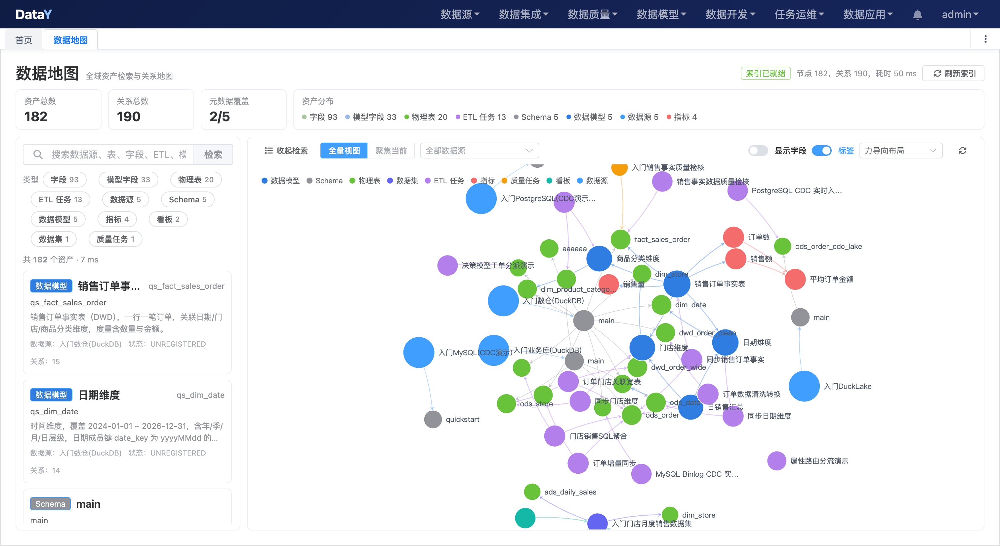

# 数据越来越多，为什么你依然“找不到数据”？

> DataY 数据地图正式上线：把数据源、表、字段、ETL、模型、指标、数据集、看板装进一张图，支持全域数据检索。

---

## 一、数据平台越建越大，找数据却越来越难

很多团队都会经历这样一个阶段：

- 数据源接入了十几套，表有几千张；
- ETL 任务越配越多，任务之间的依赖越来越复杂；
- 模型、指标、数据集、看板层层叠加；
- 元数据采集了一大堆，但真正要用的时候，还是不知道去哪找。

于是日常对话经常变成：

> “订单明细表在哪个库？”  
> “这个指标是从哪张表算出来的？”  
> “我改这张表，会影响哪些看板和 API？”  
> “这个字段是干什么的，有没有注释？”  
> “新来的同学，怎么快速看懂我们的数据体系？”

数据不是没有，而是**分散在多个模块里，缺少一个统一入口**。

DataY 数据地图要解决的，就是这个问题。

---

## 二、什么是 DataY 数据地图？

DataY 数据地图是一张覆盖全域数据资产的“导航图”。



> ▲ DataY 数据地图：左侧全域检索与类型分面，中间全量关系图，右侧资产详情，顶部展示索引状态与资产统计。

从截图中可以看到：

- 左侧是统一检索入口，支持按资产类型筛选；
- 中间是 ECharts 全量关系图，展示资产之间的上下游关系；
- 右侧是选中资产的详情；
- 顶部展示资产总数、关系总数、元数据覆盖率和索引状态。

它把平台里的数据资产统一收录进来：

- 数据源
- Schema
- 物理表
- 字段
- ETL 任务
- 数据同步任务
- 维度模型 / 事实模型
- 模型字段
- 指标
- 分析数据集
- 分析看板
- API 服务
- 质量检核任务

不仅告诉你“有什么”，还告诉你“它们之间是什么关系”。

从一张表出发，你可以看到：

- 它来自哪个数据源、哪个 Schema；
- 哪些 ETL 任务在读写它；
- 它被哪些模型映射；
- 模型又计算出了哪些指标；
- 指标被哪些数据集和看板引用；
- 哪些 API 服务正在对外暴露它。

**找数据、看血缘、做影响分析，终于有了一个统一入口。**

---

## 三、四大核心能力

### 1. 全域数据检索：一个搜索框，找遍所有资产

数据地图提供统一检索入口，支持按以下内容搜索：

- 资产名称
- 资产编码
- 表注释 / 字段注释
- 资产描述
- 限定名，例如 `public.order_detail`
- 数据源名称

搜索结果会按资产类型分面展示：

```text
数据源 / Schema / 物理表 / 字段 / ETL 任务 / 数据同步 /
数据模型 / 模型字段 / 指标 / 数据集 / 看板 / API 服务 / 质量任务
```

同时支持：

- 按资产类型筛选
- 按数据源筛选
- 关键词高亮
- 点击结果直接定位到关系图中的对应节点

不用再在多个菜单之间来回切换。

**一个搜索框，找遍数据源、表、字段、任务、模型、指标、数据集和看板。**

---

### 2. 全量关系图：把数据资产“连”起来

数据地图默认以关系图展示全域资产。

不同资产用不同颜色区分：

| 资产类型 | 颜色标识 |
|---|---|
| 数据源 | 蓝色 |
| Schema | 灰色 |
| 物理表 | 绿色 |
| 字段 | 浅绿色 |
| ETL 任务 | 紫色 |
| 数据同步 | 橙色 |
| 数据模型 | 深蓝色 |
| 指标 | 红色 |
| 数据集 | 靛蓝色 |
| 看板 | 青色 |
| API 服务 | 天蓝色 |
| 质量任务 | 黄色 |

支持：

- 全量视图 / 聚焦视图切换
- 按类型图例筛选
- 按数据源筛选
- 力导向布局 / 环形布局切换
- 节点点击查看详情
- 双击节点聚焦上下游子图
- 字段节点默认收起，一键展开

当资产规模较大时，系统会按配置上限加载并给出提示，避免浏览器被几万个节点拖垮。

**先看全局，再钻细节。**

---

### 3. 从“找到数据”到“看懂数据”

点击任意节点，右侧会打开资产详情：

- 资产类型、名称、编码、限定名
- 所属数据源、Schema、表
- 字段列表、字段类型、主键标识、注释
- 上游 / 下游关系
- 元数据采集状态
- 一键跳转到对应功能模块

例如，点开一张物理表，你可以直接看到：

- 哪些 ETL 任务在写入它；
- 它被哪个模型映射；
- 模型计算了哪些指标；
- 指标被哪些数据集和看板使用；
- 哪些 API 正在对外提供这张表的数据。

这比在多个页面之间反复跳转、手工拼关系高效得多。

---

### 4. 元数据采集结果，真正用起来

DataY 已经支持数据源元数据采集。

采集结果会生成表与字段的快照，包括：

- 表名、Schema、Catalog
- 表注释
- 字段名、字段类型
- 字段长度、精度、小数位
- 是否可空、是否主键
- 字段注释
- 采集时间

数据地图会读取最新快照，把物理表与字段纳入全域资产目录。

没有采集过元数据的数据源也不会“消失”：

- 数据源节点仍然保留；
- 被模型、ETL 引用的表会生成占位节点；
- 详情中会提示元数据未采集，引导补充采集。

**元数据采集不再只是导出一份 CSV，而是变成可检索、可关联、可导航的数据资产。**

---

## 四、典型使用场景

### 场景一：新人快速熟悉数据体系

新同学入职后，不需要先背几十张表名。

打开数据地图，搜索“订单”，就能看到：

- 订单相关的物理表；
- 订单 ETL 任务；
- 订单事实模型；
- 订单金额指标；
- 使用这些指标的数据集和看板。

从搜索结果直接进入关系图，顺着上下游看一遍，数据体系很快就建立起来了。

### 场景二：修改表结构前做影响分析

准备修改一张核心表的字段时，先在地图里找到这张表：

- 哪些 ETL 任务在读写它？
- 哪些模型依赖它？
- 哪些指标会受影响？
- 哪些看板和 API 会跟着变化？

影响范围一目了然，避免“改一张表，崩一片报表”。

### 场景三：指标口径排查

业务反馈“订单金额不对”，可以从指标反查：

```text
看板 → 数据集 → 指标 → 事实模型 → 物理表 → ETL 任务 → 数据源
```

链路清晰，排查有方向。

### 场景四：数据资产盘点

按数据源、按类型查看资产分布：

- 当前接入了多少数据源？
- 有多少张表已经采集元数据？
- 哪些数据源还没有元数据？
- 模型、指标、数据集、看板分别有多少？

数据治理不再靠手工 Excel。

---

## 五、怎么使用？

DataY 登录后，数据地图固定在顶部页签中，排在“首页”后面，随时可以打开。

首次进入时：

1. 系统自动在后台构建当前租户的数据地图索引；
2. 构建完成后即可检索和查看关系图；
3. 后续元数据采集成功后，索引会标记为待刷新；
4. 管理员可点击“刷新索引”手动重建。

建议配合元数据采集使用：

```text
数据源 → 配置元数据采集 → 执行采集 → 打开数据地图 → 全域检索
```

字段节点默认不显示，需要查看字段级关系时，打开“显示字段”即可。

---

## 六、结语

数据平台的价值，不只是把数据接进来、算出来。

更重要的是：**让需要数据的人，能够快速找到数据、理解数据、信任数据。**

DataY 数据地图做的，就是把散落在各个模块里的数据资产，重新组织成一张可检索、可浏览、可追溯的关系网络。

从“这个表在哪”，到“这个指标怎么来的”，再到“改这张表会影响谁”，都可以在一个入口完成。

**全域数据检索，从此不再靠问人。**

---

## 关于 DataY

DataY 是一款轻量级、一体化数据平台。

它的核心理念是：**用最精简的技术栈，交付完整的数据能力。**

一套 DataY 跑起来，就能覆盖从数据接入、数据处理、任务调度，到维度建模、指标管理、数据地图、智能问数的完整链路。

主要能力包括：

- **数据集成**：支持 MySQL、PostgreSQL、Oracle、SQL Server、达梦、Doris、ClickHouse、DuckDB 等二十余种数据源，支持批量同步、CDC 实时同步、跨库比对；
- **任务调度**：Cron 定时调度、DAG 工作流编排、失败重试、任务运维；
- **维度建模**：星型 / 雪花模型、事实表与维度表关联、模型物化；
- **指标管理**：原子指标、衍生指标、统一业务口径；
- **数据地图**：全域资产检索、上下游关系地图、影响分析；
- **智能问数**：自然语言 → 指标 → 维度 → 时间过滤 → 取数；
- **数据应用**：API服务、分析看板、应用资产包。

DataY 不依赖 Hadoop、Spark 等重型组件，一个 JAR 就能启动。

开发机 2 核 4G 即可跑通从数据接入到报表查询的完整链路。

对于希望低成本落地数据平台、又不想维护一堆组件的团队来说，DataY 提供了一种更轻、更直接的选择。

---

- 产品首页：<http://datay.yuyuejia.com.cn/>  
- 在线体验：<http://datay-demo.yuyuejia.com.cn/>  
- Github：<https://github.com/yuyuejia/datay>
- Gitee：<https://gitee.com/yuyuejia/datay>
