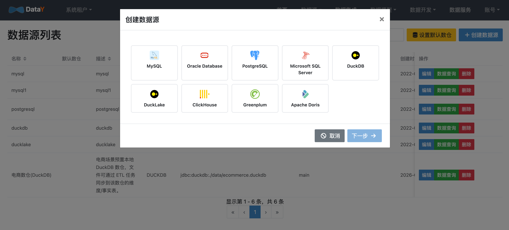

# 数据源管理

数据源是 DataY 的数据出入口。数据集成、数据同步、元数据浏览都依赖这里注册的连接。

导航：**数据源 → 数据源管理**。

## 新建数据源

1. 点击「新建数据源」。
2. 填写名称、类型、连接 URL、默认 schema 等信息。
3. 点击「测试连接」确认连通。
4. 保存。

以 DuckDB 为例：

| 字段 | 示例 |
| --- | --- |
| 名称 | `电商数仓(DuckDB)` |
| 类型 | `DUCKDB` |
| 连接 URL | `jdbc:duckdb:./metadata.duckdb` |
| 默认 schema | `main` |
| 用户名 / 密码 | 按数据库要求填写 |

## 测试连接

- 保存前建议先点「测试连接」，确认驱动、URL、账号密码正确。
- 连接失败时优先检查：网络是否可达、端口是否正确、账号权限、URL 参数（如时区、SSL）。

## 元数据浏览

在数据源详情中可浏览 **schema → table → column** 层级元数据，用于：

- 确认目标表是否已生成、字段是否齐全
- 为 ETL 节点、注册模式导入字段提供参考

## 数据查询与表血缘

在数据源详情进入「数据查询」后，左侧选择表并打开表详情，可以查看：

- 字段信息
- 索引信息
- 数据预览
- 数据血缘

「数据血缘」会展示当前物理表、绑定到该表的数据模型，以及模型关联的维度、指标、衍生指标和看板；同时包含数据同步、ETL 对该表的读写关系。ETL 任务会继续向上展开其来源物理表，并向下展开输出物理表，继续追踪输出表绑定的模型、指标和看板。血缘图以当前表为高亮根节点，便于从物理表反查业务模型和下游应用。

## 支持的数据源

| 分类 | 数据源 |
| --- | --- |
| 关系型数据库 | MySQL、Oracle、PostgreSQL、SQL Server、MariaDB、SAP HANA |
| 时序数据库 | TDengine |
| 分析数据库 | DuckDB、Doris、ClickHouse、GreenPlum |
| 文件系统 | 本地文件、MinIO 对象存储 |
| CDC | MySQL Binlog、PostgreSQL 逻辑复制（WAL / pgoutput） |

### TDengine 连接说明

TDengine 是一种时序数据库，DataY 支持数据源管理、元数据浏览、数据查询和 ETL 读写。新建数据源时类型选择 `TDENGINE`，默认使用 WebSocket 协议：

| 协议 | 连接 URL 示例 | 默认端口 | 驱动类 |
| --- | --- | --- | --- |
| WebSocket（默认） | `jdbc:TAOS-WS://127.0.0.1:6041/power` | `6041` | `com.taosdata.jdbc.ws.WebSocketDriver` |
| REST | `jdbc:TAOS-RS://127.0.0.1:6041/power` | `6041` | `com.taosdata.jdbc.rs.RestfulDriver` |
| 原生 | `jdbc:TAOS://127.0.0.1:6030/power` | `6030` | `com.taosdata.jdbc.TSDBDriver` |

- 前端默认按 WebSocket 拼接 URL；REST 或原生连接通过「自定义 URL」直接填写。
- `taos-jdbcdriver` 不随平台打包，首次连接时按需从 Maven 仓库下载 `-dist` 完整包，请确保运行环境可访问 Maven 仓库。
- 原生协议依赖本机 TDengine 客户端原生库；容器化部署建议优先使用 WebSocket 或 REST。
- TDengine 没有 schema 概念，**database 会作为 schema 展示**；左侧元数据树按 `database → table → column` 浏览。
- 每个表必须包含一个 `TIMESTAMP` 时间列，ETL 自动建表时会将该列放在第一列。
- TDengine 相同时间戳重复写入会覆盖旧值，因此 ETL 的 `update` 模式在 TDengine 上等价于 `insert/upsert`。
- **超级表（STable）不能直接执行普通 INSERT/UPDATE**。需要写入超级表时，请使用 `SqlSink` 并配置 `INSERT INTO 子表 USING 超级表 TAGS (...) VALUES (...)`；普通 ETL 输出节点会提前拦截并给出提示。

## 下一步

- [数据集成与同步](guide/integration.md)：用注册好的数据源编排同步任务
- [ETL 组件介绍](components/StreamJdbcInput.md)：了解各数据源对应的输入 / 输出组件
