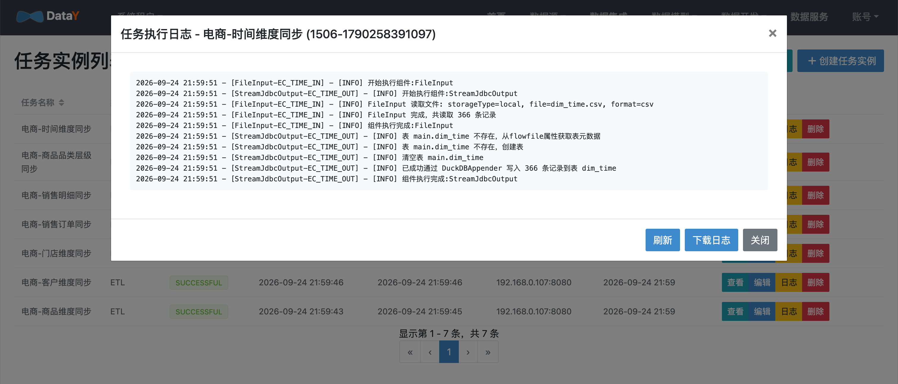

# 任务调度与实例

DataY 基于 **Quartz** 提供定时调度、依赖调度与实例监控能力。

## 调度能力

- **Cron 定时调度**：任务上线后自动注册调度，支持动态上线 / 下线
- **依赖调度**：通过任务依赖（JobDepend）配置父子关系，父任务成功后触发子任务；依赖未满足时实例进入 WAITING 状态，由 WaitingJobQuartzTask 定时轮询恢复
- **手动触发**：支持任务立即执行一次（RUN）
- **失败重试**：运行中的任务支持终止，失败任务可重新执行

## 上线与下线

1. 在任务列表点击「上线」，任务即加入调度。
2. 再次点击「下线」，任务从调度中移除。

只有上线的任务才会按 Cron 规则自动触发。

## 调度部署模式

调度系统由 **master（调度）** 与 **worker（执行）** 两类角色组成，通过 `development.mode`
配置项声明当前进程承担的角色：

| 配置 | 说明 | 调度能力 | 执行能力 | 依赖 Redis |
| --- | --- | --- | --- | --- |
| `standalone` | 单机部署，调度与执行合一（默认） | 有 | 有 | 否 |
| `master` | master 独立部署，只负责调度，不执行任务 | 有 | 无 | 是 |
| `worker` | worker 独立部署，只负责执行任务，不参与调度 | 无 | 有 | 是 |
| `master,worker` | 同一个服务同时具备调度与执行能力 | 有 | 有 | 是 |
| `standalone,worker` | 按单机配置运行，同时额外承担 worker 职能 | 有 | 有 | 是 |

`standalone` 表达的是「单机部署」这一形态，可以和 master / worker 角色组合书写；
只写 `standalone` 时进程内事件不走 Redis，一旦带上 `master` / `worker` 就改用 Redis 事件通道。
多个角色用逗号分隔，分隔符同时支持分号与空格，大小写不敏感。

角色职责划分：

- **master**：初始化 Quartz 调度、维护任务上线 / 下线、接收 worker 上报的任务状态并落库，通过 Redis 队列下发待执行任务
- **worker**：从 Redis 队列消费待执行任务并执行，上报执行状态与日志，不初始化 Quartz 调度
- 多 master 部署时通过 Redis 分布式锁进行 Leader 选举，只有 Leader 负责调度，保证调度一致性

### 启动方式

部署角色统一由 `development.mode` 表达，**不需要额外的 Spring profile**：

```bash
# 单机部署（默认，无需 Redis）
java -jar target/*.jar --spring.profiles.active=prod

# master 独立部署（仅调度，可多副本由 Leader 选举保证唯一性）
java -jar target/*.jar --spring.profiles.active=prod --development.mode=master

# worker 独立部署（仅执行，可水平扩展提升吞吐）
java -jar target/*.jar --spring.profiles.active=prod --development.mode=worker

# 同一个服务同时具备 master 与 worker 职能
java -jar target/*.jar --spring.profiles.active=prod --development.mode=master,worker
```

带 `master` / `worker` 角色的部署需要配置 Redis：

```yaml
spring:
  data:
    redis:
      host: 127.0.0.1
      port: 6379
      password: ''
      database: 0
```

也可以通过环境变量配置：`SPRING_DATA_REDIS_HOST` / `SPRING_DATA_REDIS_PORT` / `SPRING_DATA_REDIS_PASSWORD`，
以及部署角色 `DEVELOPMENT_MODE`（如 `DEVELOPMENT_MODE=master,worker`）。

### 容器编排

master / worker 分离部署的容器编排参考示例见
[`src/main/docker/scheduler-cluster.yml`](https://github.com/yuyuejia/datay/blob/main/datay-web/src/main/docker/scheduler-cluster.yml)：

```bash
# 启动 master 与 worker
docker compose -f src/main/docker/scheduler-cluster.yml up -d
# worker 横向扩展
docker compose -f src/main/docker/scheduler-cluster.yml up -d --scale worker=3
```

## 并发与容量配置

单机同一时刻真正并发执行的任务数、待执行队列，以及 Quartz 触发线程数都可以配置：

| 配置项 | 默认值 | 说明 |
| --- | --- | --- |
| `development.worker.thread-count` | 50 | 单节点同时执行的任务数上限，超出后进入待执行队列 |
| `development.worker.queue-capacity` | 50 | 待执行队列容量，满后 worker 暂停从事件队列取任务（背压） |
| `development.scheduler.thread-count` | 10 | Quartz 触发线程数，决定同秒大量任务到期时并发拉起实例的能力 |

```yaml
development:
  scheduler:
    thread-count: 30
  worker:
    thread-count: 200
    queue-capacity: 2000
```

也可以用环境变量覆盖：`DEVELOPMENT_SCHEDULER_THREAD_COUNT`、`DEVELOPMENT_WORKER_THREAD_COUNT`、
`DEVELOPMENT_WORKER_QUEUE_CAPACITY`。

调优建议：

- 触发线程数建议不超过数据库连接池（Hikari `maximum-pool-size`，默认 10），避免触发阶段打满连接池；
- worker 线程数按 CPU / 内存与任务类型调整。几十个并发 ETL 在 2C4G 上就不现实，应改用 docker 模式或多 worker 副本；
- 若显式配置了 `spring.quartz.properties.org.quartz.threadPool.threadCount`，则以该值为准。

### 单节点容量实测（4G 内存）

以下数据来自实际测量（JDK 17；`-XX:MaxRAM=4g` 时默认 `MaxHeapSize` 约 1G，`MaxRAMPercentage=25`；
入口脚本启用 `-XX:+AlwaysPreTouch`，堆启动即全部占用）。测量方法为批量分配后 GC 的堆增量，
Quartz 部分为真实 `scheduleJob` 注册 2 万 / 5 万个 Cron 任务。

单对象堆占用：

| 对象 | 实测占用 |
| --- | --- |
| `JobInstance` 本体（无 `jobContext`） | 332 B |
| `JobInstance` + 2KB / 10KB / 50KB `jobContext` | 2.36KB / 10.36KB / 50.36KB |
| `JobStatusEvent` 包一层 | 约 +80 B |
| Quartz 注册一个 Cron 任务（JobDetail + CronTrigger + RAMJobStore） | **约 11.7KB** |

单节点容量（按 1G 堆、扣除应用基线约 400MB、可用约 600MB 估算）：

| 维度 | 4G 默认（堆约 1G） | 4G 显式 `-Xmx2g` |
| --- | --- | --- |
| 同时执行任务 | 50（线程数上限） | 50 |
| 在途实例（排队 + 执行） | 不超过 1 万，`jobContext` ≤50KB 才安全 | 1 万 × 100KB 仍可 |
| 注册中的 Cron 任务 | 稳态约 5 万；含启动峰值实际 1–3 万 | 稳态约 12 万；实际 3–7 万 |
| 本地 ETL 并发建议 | 10–20 | 20–30 |

`jobContext` 与在途实例内存（1 万条队列）：

| `jobContext` | 单条实例 | 1 万条占用 | 1G 堆 |
| --- | --- | --- | --- |
| 2KB | 2.44KB | 24MB | 可用 |
| 4KB | 4.44KB | 44MB | 可用 |
| 10KB | 10.44KB | 104MB | 可用 |
| 50KB | 50.44KB | 504MB | 接近上限 |
| 100KB | 100.44KB | 约 1.0GB | 有 OOM 风险 |
| 200KB | 200.44KB | 约 2.0GB | 不可用 |

注册中的 Cron 任务还受启动阶段影响：`QuartzService.initJobScheduler()` 会把所有 ONLINE 任务连同
`jobContext` 一次性加载再逐个注册，启动峰值约为 `N × (11.7KB + Job 实体 + jobContext)`：

| `jobContext` | 1G 堆可注册 | 2G 堆可注册 |
| --- | --- | --- |
| 2KB | 约 4.3 万 | 约 10 万 |
| 10KB | 约 2.7 万 | 约 6.8 万 |
| 50KB | 约 0.97 万 | 约 2.4 万 |
| 100KB | 约 0.54 万 | 约 1.3 万 |

因此建议单节点在线 Cron 任务控制在 **1 万以内**（`jobContext` 较小时可到 2–3 万）；更大规模应增加
master 分片，而不是继续加内存。

4G 单节点的推荐配置：

```yaml
development:
  scheduler:
    thread-count: 10
  worker:
    thread-count: 20        # 纯 SQL/Shell 可回到 50；本地 ETL 建议 10–20
    queue-capacity: 50
```

```bash
JAVA_OPTS="-Xmx2g -Xms2g"
```

注意：

- 4G 机器不建议 `-Xmx3g`：`AlwaysPreTouch` 会立即占满，加上 Metaspace、CodeCache、线程栈与直接内存，
  留给系统和其他进程的空间过小；
- 执行侧待执行队列使用 `PriorityBlockingQueue(queueCapacity, ...)`，该参数只是初始容量，队列本身无界，
  真正限制在途数量的是容量 1 万的 `startJobQueue` / `jobStatusQueue`；
- 状态队列也可能同时压入最多 1 万条事件引用，极端情况下在途内存会接近翻倍。

## ETL 任务执行模式

ETL 任务默认在 worker 进程内执行；也可以通过配置切换为 **docker 模式**：任务在独立的
docker 容器中执行，容器提供 Java 运行环境，任务 jar、驱动目录与日志目录通过挂载共享给容器。
这样可以把 ETL 运行时与调度进程隔离，避免任务依赖或内存占用影响调度服务。

```yaml
development:
  etl:
    mode: docker            # local（默认，进程内执行）| docker
    docker:
      image: eclipse-temurin:17-jre
      # 运行时来源一（推荐）：独立构建的 core 可执行 jar
      jar-path: /opt/datay/datay-core-1.0.1-SNAPSHOT-jar-with-dependencies.jar
      # 运行时来源二：直接引用 worker fat jar 内嵌的 core（不配 jar-path 时生效，留空自动探测）
      # worker-jar-path: /opt/datay/datay-web-1.0.1-SNAPSHOT.jar
      network: host         # 一般无需配置：默认网络可访问局域网/公网数据源
      # 访问宿主机服务（本地数据库/模型服务）：默认开启，无需配置
      # host-access: true
      # host-access-alias: host.docker.internal
      memory: 2g
      host-log-dir: /opt/datay/log       # 缺省 <工作目录>/log
      driver-dir: /opt/datay/drivers     # 缺省 <工作目录>/drivers
      data-dir: /opt/datay/data          # 缺省 <工作目录>/data（DuckDB 等相对路径数据文件）
      # 附加驱动 / 组件 jar 目录，挂载到容器 /app/lib 并加入 classpath
      # lib-dirs:
      #   - /opt/datay/lib
```

也可通过环境变量覆盖：`DATAY_ETL_MODE`、`DATAY_ETL_DOCKER_IMAGE`、`DATAY_ETL_DOCKER_JAR_PATH`、
`DATAY_ETL_DOCKER_WORKER_JAR_PATH`、`DATAY_ETL_DOCKER_NETWORK`、`DATAY_ETL_DOCKER_HOST_ACCESS`、
`DATAY_ETL_DOCKER_HOST_LOG_DIR`、`DATAY_ETL_DOCKER_DRIVER_DIR`、`DATAY_ETL_DOCKER_DATA_DIR`。

### 运行时来源

docker 模式按以下优先级自动选择 ETL 运行时，**开发模式下通常只需把 `mode` 改成 `docker` 即可**，
无需手动配置 jar 路径：

1. **独立 core jar（生产推荐）**：配置 `jar-path` 指向单独构建的
   `datay-core-<version>-jar-with-dependencies.jar`。容器以
   `java -cp /app/datay-core.jar com.data.DataY` 执行，体积小、依赖可控。
2. **worker 内嵌 core**：`worker-jar-path` 指定 worker 的 Spring Boot fat jar，或留空自动探测当前运行的
   worker jar；通过 `PropertiesLauncher` 加载其内嵌的 `BOOT-INF/lib` 运行时执行 `com.data.DataY`。
3. **工程内自动探测 core jar**：开发态（IDE / 展开目录启动）自动向上查找
   `datay-core/target/*-jar-with-dependencies.jar`。
4. **开发态 classpath（兜底）**：以上都没有时，直接挂载当前进程的 classpath
   （`target/classes` + Maven 依赖目录）在容器内以相同绝对路径运行，因此 IDE 直接启动 worker 也能跑，
   无需先构建任何 jar。生产环境建议使用方式 1，避免挂载 Maven 仓库。

### 工作原理

1. worker 把任务 JSON 写入宿主机日志目录（`<host-log-dir>/<jobCode>/<instanceCode>.job.json`）
2. 执行 `docker run` 启动容器：容器工作目录为 `/app`，宿主日志目录挂载为 `/app/log`，
   驱动目录挂载为 `/app/drivers`，数据目录挂载为 `/app/data`；运行时 jar 挂载为 `/app/datay-core.jar`（core jar 模式）
   或 `/app/datay-web.jar`（worker 内嵌模式）
3. 容器内执行任务并直接写宿主机日志目录：core jar 模式为
   `java -cp /app/datay-core.jar:/app/lib/* com.data.DataY <jobFile>`；worker 内嵌模式为
   `java -cp /app/datay-web.jar -Dloader.main=com.data.DataY org.springframework.boot.loader.launch.PropertiesLauncher <jobFile>`
4. 以容器退出码判定任务状态：0 为成功，非 0 为失败；停止任务时 `docker rm -f` 清理容器

### 前置条件

- worker 主机已安装并可执行 `docker`，且启动进程的用户有权限访问 docker
- 运行时来源二选一：配置 `jar-path` 指向独立构建的 core jar
  （`mvn -pl datay-core -am package -DskipTests`，产物为
  `datay-core/target/datay-core-<version>-jar-with-dependencies.jar`）；
  或使用 worker 内嵌模式（不配 `jar-path`，由 `worker-jar-path` 指定或自动探测运行的 worker jar）
- 数据源访问默认开箱可用：
  - 数据源在**局域网 / 公网**（如 `10.x`、域名）时无需任何配置，docker 默认网络即可访问；
  - 数据源在**宿主机本机**（`localhost` / `127.0.0.1`）时，默认启用 `host-access`：容器注入
    `--add-host host.docker.internal:host-gateway`，并把任务 JSON 中的回环地址改写为
    `host.docker.internal`，从而连上宿主机数据库/服务。如需关闭，设置 `host-access: false`；
    自定义别名用 `host-access-alias`。
  - 需要特殊网络模式（如 `host`）时再配置 `network`
- 未随 jar 内置的 JDBC 驱动（如达梦、Elasticsearch）放在宿主 `driver-dir`，容器可直接加载；
  如需在容器内按需下载驱动，`driver-dir` 需可写，并可通过 `driver-repos` 指定 Maven 仓库

### 状态存储

增量同步状态通过挂载目录或对象存储与宿主共享：

- `local`（默认）：容器内写入 `/app/log`，与宿主 `host-log-dir` 共享
- `minio`：worker 把状态存储配置（endpoint / access-key / secret-key / bucket）透传给容器，
  容器直接读写 MinIO，多节点共享状态

## 任务实例监控

导航：**任务实例**。

- 实例状态全程跟踪：APPENDING / RUNNING / WAITING / SUCCESSFUL / FAILED / TIMEOUT / INTERRUPTED
- 记录执行节点（`IP:端口`）、开始 / 结束时间、执行消息
- 支持停止运行中的实例



## 下一步

- [数据集成与同步](guide/integration.md)：ETL 状态持久化与增量恢复
- [任务设计与开发](guide/development.md)：任务类型与 DAG 编排
